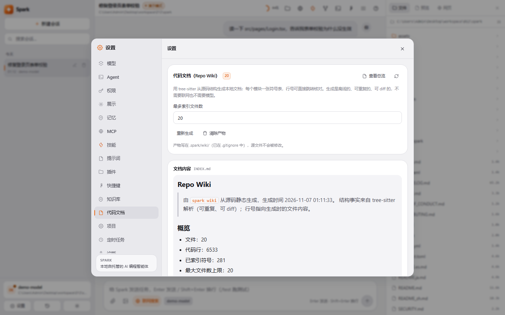
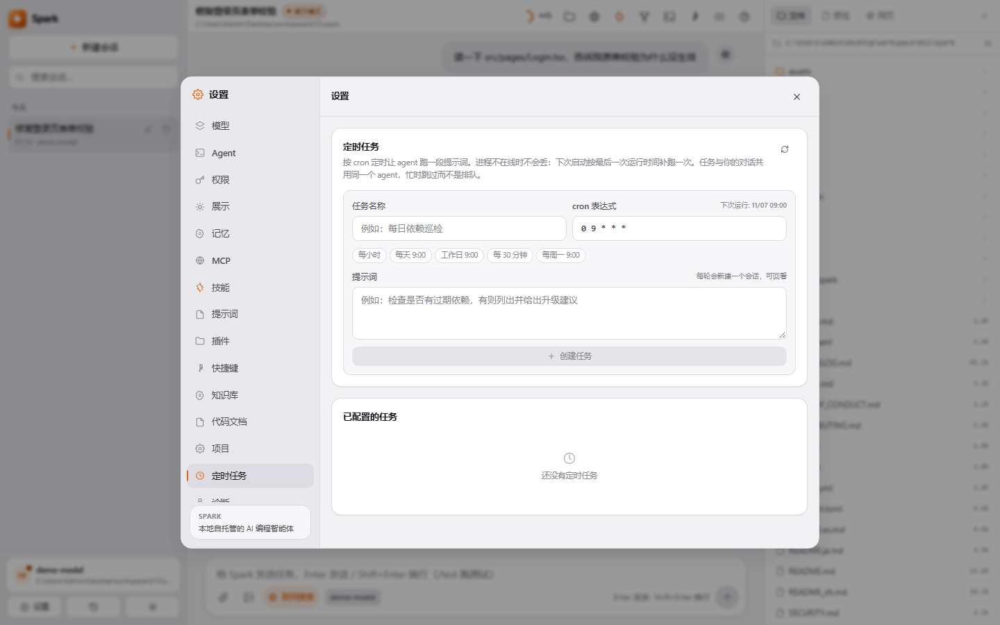

> 🌐 **English** | [中文](README_zh.md)

# Spark

**A local-first AI coding agent with guardrails you can audit.**

[](https://opensource.org/licenses/MIT)
[](https://www.python.org/)
[](https://nodejs.org/)
[](https://github.com/badhope/spark/actions/workflows/ci.yml)
[](https://github.com/badhope/spark/actions/workflows/security.yml)

Approval, three-OS sandboxing, checkpoint rollback and provider resilience are
engineered in — not bolted on. One agent loop, seven surfaces. Bring your own
OpenAI-compatible endpoint: no account, no telemetry, no vendor lock-in.

```bash
# Linux / macOS — SHA256-verified
curl -fsSL https://raw.githubusercontent.com/badhope/spark/main/scripts/install.sh | sh

# Windows (PowerShell)
irm https://raw.githubusercontent.com/badhope/spark/main/scripts/install.ps1 | iex

spark init    # point it at any OpenAI-compatible endpoint
spark web     # open the UI (auto-picks a free port)
```

No API key? Spark starts in **demo mode** with a mock model. Paste a key in
settings and the next turn uses the real model — no restart.

<p align="center">
  
</p>

---

## What it does for you

| | |
|---|---|
| **Seven surfaces, one brain** | Web UI · desktop window · Textual TUI · scriptable CLI · ACP (Zed & co.) · MCP server · A2A server. Same loop, same tools, same permissions everywhere. |
| **Approval you can audit** | Six approval modes × four sandbox levels. A wildcard rule engine where `deny` wins across user/project/local scopes. Protected credential paths. Token-level shell checks. |
| **Rollback without fear** | Every turn snapshots the workspace (tar.gz + manifest verification). Roll back files *and* conversation — works in non-git directories. |
| **Task-as-branch** | `task_begin` → `task_step_commit` → `task_finish`. Green tests gate each commit; a red run abandons the branch. A first-class tool, not a demo. |
| **AI reviews AI** | `spark review` audits your diff in a forced read-only, sandbox-only turn and returns severity-ranked findings. `--json` for CI. |
| **Resilient providers** | A credential pool rotated on failure, a fallback model chain, and a small model for cheap auxiliary calls. One exhausted key never blocks a turn. |
| **Memory with governance** | AGENTS.md hierarchy (global + project + nested) plus vector long-term memory with dedup merge and capacity eviction, manageable from the UI. |

## See it

**Settings — models.** Any OpenAI-compatible endpoint, saved profiles, a real
connection probe, three reasoning-effort levels mapped to provider-native params.


**Settings — permissions and sandbox.** Four access levels with explicit
behaviour descriptions. The protected-path list is user-editable; `.git/hooks`,
`~/.spark` and Spark's own source always stay protected.


**Settings — code wiki.** Generate a traceable manual from your source tree:
one symbol table per module, real line numbers, incremental rebuilds, no
network and no model required.



**Scheduled tasks.** Cron-triggered prompts that share the same agent. Work
missed while the process was down is caught up once on the next start; a busy
agent skips rather than queues.



**Command palette.** `Ctrl+K` fuzzy-jumps to every surface: new session,
checkpoints, turn replay, file viewer, web reader, share export, theme, language.


## Quick start

```bash
spark                         # TUI
spark web                     # browser UI on 127.0.0.1 (auto-picks a port)
spark desktop                 # native window, loopback only
spark exec "task" --json      # NDJSON event stream for scripts and CI
spark review                  # audit the uncommitted diff
spark wiki --refresh          # regenerate the local code wiki
spark doctor                  # diagnose config, credentials, runtime
spark uninstall --list        # show exactly what would be removed
```

`spark exec` streams one JSON object per line and ends with
`{"type":"final","text":"…"}`, so it pipes into `jq` without post-processing.

## Seven surfaces

| Form | Command | Use case |
|---|---|---|
| Web UI | `spark web` | Everyday chat, file viewer, terminal, execution graph |
| Desktop | `spark desktop` | Native pywebview window, loopback-only |
| TUI | `spark` | Pure terminal / SSH |
| CLI | `spark exec "task" --json` | Automation, CI, piping |
| IDE (ACP) | `spark acp` | Zed and other ACP clients — [docs/ACP.md](docs/ACP.md) |
| MCP server | `spark mcp-serve` | Expose every built-in tool to other MCP clients |
| A2A server | `spark a2a-serve` | Agent-to-agent delegation — [docs/A2A.md](docs/A2A.md) |

## How the guardrails fit together

Three layers, each narrowing the previous one:

1. **Approval** — six modes from `plan-only` (plan, change nothing) to
   `full-auto`. The default `suggest` asks before any write or command.
2. **Sandbox** — `sandbox-only` / `workspace` (default) / `full-access` /
   `unrestricted`. Path escapes and protected paths are refused outright.
3. **Rules** — `[[permission_rules]]` match tool + resource across three scopes.
   `deny` wins across scopes, so a cloned repository can tighten permissions
   but never grant itself more.

OS-level isolation is layered on top: bwrap on Linux, a Job Object on Windows
(process-tree kill-on-close plus a memory ceiling), `sandbox-exec` on macOS.
Where a platform cannot enforce something, the tool result says so instead of
pretending.

## Verified locally, not just in CI

```bash
pytest -q                                  # ~1400 tests
ruff check src tests scripts
mypy src/spark --ignore-missing-imports
bandit -r src/spark -ll -ii -c bandit.yaml
lint-imports                               # 5 architecture contracts
```

CI additionally runs secret scanning (gitleaks + trufflehog), an OpenAPI
snapshot freshness check, a coverage floor, a Windows-reserved-path check,
packaging checks, and a mock-mode agent eval suite on Linux and Windows.

## Documentation

| Document | Contents |
|---|---|
| [docs/INSTALL.md](docs/INSTALL.md) | Install, package, desktop build, auto-update, uninstall |
| [docs/CONFIG.md](docs/CONFIG.md) | Every config key and environment variable |
| [docs/API.md](docs/API.md) | HTTP API and SSE event protocol |
| [docs/ARCHITECTURE.md](docs/ARCHITECTURE.md) | Layering and module boundaries |
| [docs/FEATURES.md](docs/FEATURES.md) | Feature-by-feature implementation map |
| [docs/A2A.md](docs/A2A.md) | A2A agent card, streaming, task lifecycle |
| [docs/competitive-comparison.md](docs/competitive-comparison.md) | How it compares to Qoder / ZCode / opencode / Codex CLI |
| [docs/reviews/](docs/reviews/) | Audit reports with findings, fixes and honest limits |
| [vscode-spark/](vscode-spark/) | VS Code extension |

## Platform requirements

- Python 3.11+ — or the bundled executable, no Python needed
- Node.js 18+ for frontend development only (release builds ship compiled assets)
- Windows / macOS / Linux

---

**License:** MIT · **Author:** badhope
