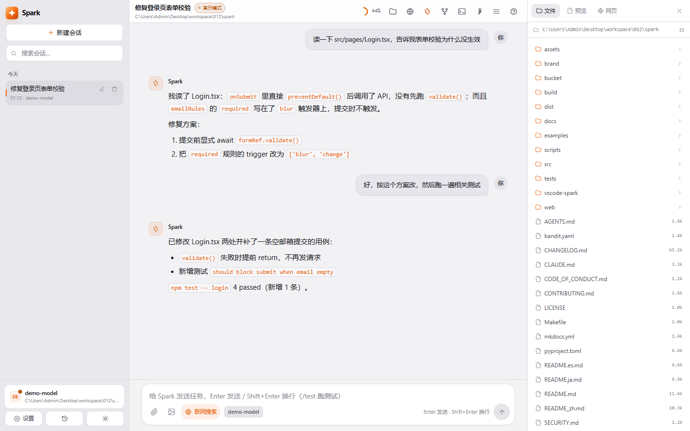
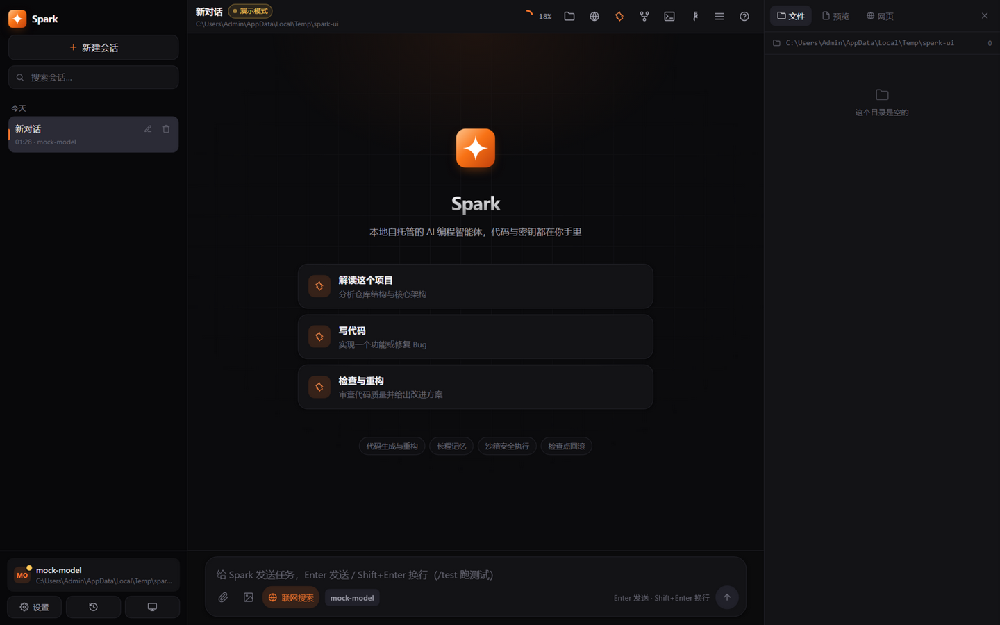
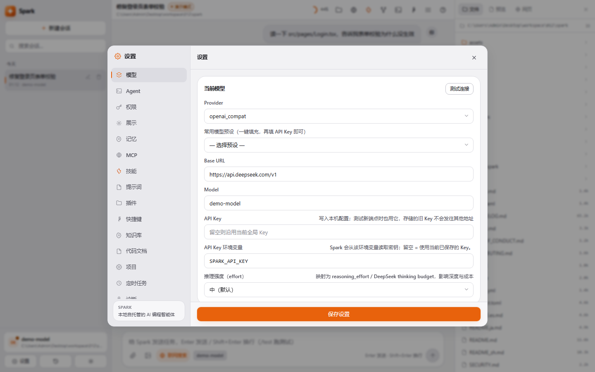
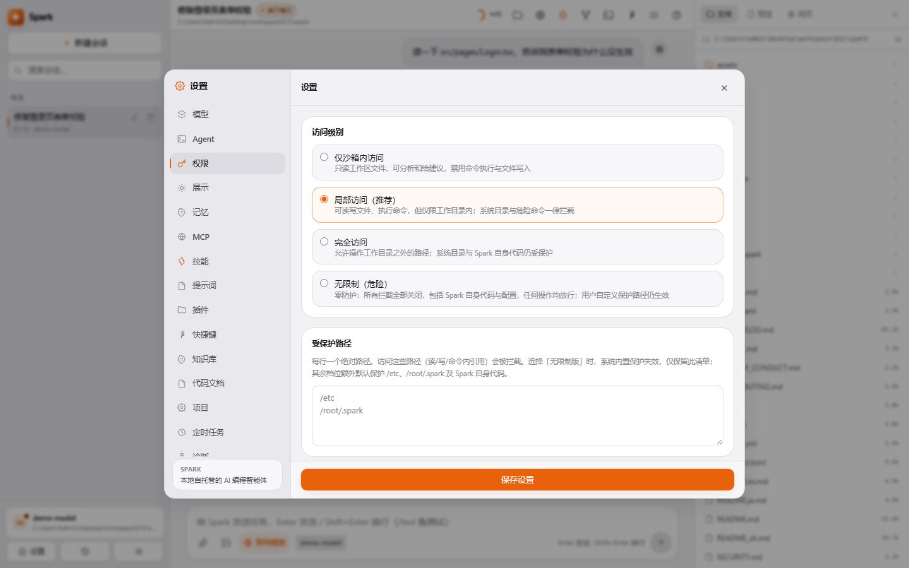
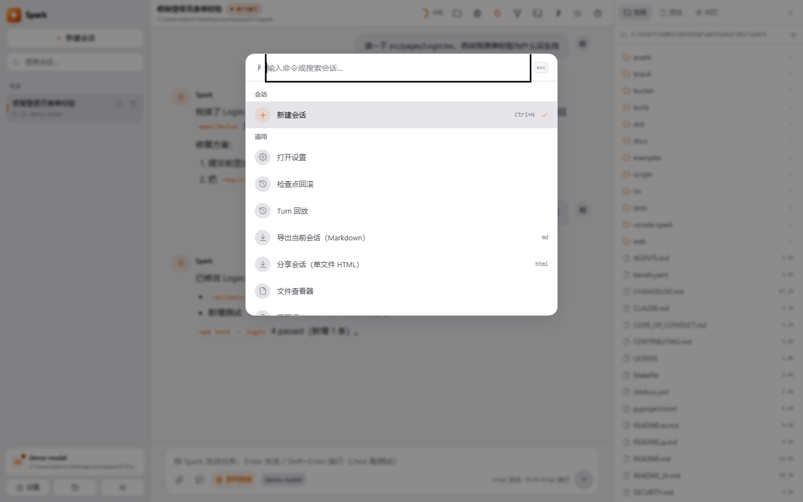

> 🌐 [English](README.md) | [中文](README_zh.md)

# Spark — One agent brain. Seven surfaces. Guardrails you can audit.

[](https://opensource.org/licenses/MIT)
[](https://www.python.org/)
[](https://nodejs.org/)
[](https://github.com/badhope/spark/actions/workflows/ci.yml)
[](https://github.com/badhope/spark/actions/workflows/security.yml)
[](https://github.com/badhope/spark/tree/main/bucket)

An AI coding agent where **approval, sandboxing, rollback and provider resilience are
engineered, not bolted on** — the same brain runs as Web UI, desktop window, TUI,
scriptable CLI, ACP (IDE) and MCP server. Bring your own OpenAI-compatible endpoint;
no account, no telemetry, no vendor lock-in.

```bash
# Linux / macOS — one line, SHA256-verified
curl -fsSL https://raw.githubusercontent.com/badhope/spark/main/scripts/install.sh | sh

# Windows (PowerShell)
irm https://raw.githubusercontent.com/badhope/spark/main/scripts/install.ps1 | iex

spark init          # configure any OpenAI-compatible endpoint
spark web           # open the UI (auto-picks a free port)
```

Without an API key Spark starts in **demo mode (mock)**; paste a key in settings and
the next turn uses the real model — no restart.

---

## Why Spark

| | |
|---|---|
| **Seven surfaces, one brain** | Web UI · native desktop window · Textual TUI · scriptable CLI · ACP (Zed & co.) · MCP server · A2A server. Same agent loop, same tools, same permissions — a policy set once applies everywhere. |
| **Approval you can audit** | Six approval modes × four sandbox levels, wildcard rule engine where `deny` wins across user/project/local scopes, protected credential paths, token-level shell checks, optional bwrap isolation. |
| **Checkpoint instead of fear** | Every turn snapshots the workspace (tar.gz + manifest verification). Roll back files *and* conversation, including in non-git directories. |
| **Task-as-branch** | `task_begin` / `task_step_commit` / `task_finish`: green tests gate each commit, failures abandon the branch. Not a demo — a first-class tool. |
| **AI reviews AI** | `spark review` audits your uncommitted diff (or a commit range) in a forced read-only, sandbox-only turn and returns severity-ranked findings, with `--json` for CI. |
| **Provider resilience, built-in** | A credential pool (multiple keys rotated on failure), a fallback model chain, and a `small_model` for compression/summary calls — one exhausted key or rate limit never blocks a turn. |
| **Protocols at every boundary** | MCP *client + server* (stdio/SSE/HTTP, allowlists, OAuth), ACP for editors, and an **A2A server** (`spark a2a-serve`) so orchestrators can delegate tasks under the Linux Foundation agent-to-agent standard. |
| **`!cmd` inline shell** | Run any command inside a chat message — zero tokens, zero approval noise — rendered as a collapsible result card. |
| **Memory with governance** | AGENTS.md hierarchy (global `~/.agents` + project + nested) plus vector long-term memory with auto-extraction, dedup merge (UPDATE/NOOP) and capacity eviction — all manageable from the web UI. |

## Preview

> Every screenshot below comes from a **live session against a real model** on a real
> workdir — no mock, no mock-up. Regenerate them with
> `python scripts/capture_screenshots.py` (core surfaces) and
> `python scripts/capture_round7.py` (inline shell, share, notifications); the
> 30-second tour is rebuilt with `python scripts/build_promo.py` + ffmpeg.

[](assets/spark-demo.mp4)

**▶ [Watch the 30-second tour (MP4, 1.3 MB)](assets/spark-demo.mp4)** ·
[GIF preview](assets/share/spark-demo.gif)

### Chat — reasoning, tool call, answer

The model read `greet.py`, reasoned about it, and answered in one sentence. The
`read_file` card shows **✓ Completed** — a real tool round-trip over SSE, with a live
context-usage meter in the header.



### Inline shell — type `!` and run it

`!echo hello && ls` runs in the workdir through the same policy and sandbox as the
`run_shell` tool, rendered as a local card. Output never enters the model context, so
quick shell work costs zero tokens.


### Landing — pick up where you left off

Session sidebar grouped by recency, searchable history, and the model/approval/sandbox
state always visible.



### Settings — models

Any OpenAI-compatible endpoint (DeepSeek / Qwen / GLM / Kimi / Doubao / Ollama /
custom), saved model profiles with one-click switching, a *Test connection* probe, and
three reasoning-effort levels mapped to provider-native parameters.



### Settings — permissions and sandbox

Four access levels with explicit behaviour descriptions. The protected-path list is
user-editable; `.git/hooks`, `~/.spark` and Spark's own source are always protected.



### Command palette — Ctrl+K

Fuzzy-jump to every surface: new session, checkpoints, turn replay, file viewer, web
reader, share export, theme, language.



### File viewer — syntax highlighting

Browse the workdir and preview files with line numbers and highlight.js colouring, plus
graceful handling of binary and oversized files.


### Responsive — desktop and phone

The same UI at 390 px: the sidebar collapses to a drawer, settings tabs scroll
horizontally, and the composer stays reachable.


## Seven Surfaces, One Brain

| Form | Command | Use case |
|------|---------|----------|
| Web UI | `spark web` | Everyday chat, file viewer, terminal, execution graph (auto-picks a free port) |
| Desktop | `spark desktop` | Native pywebview window, loopback-only |
| TUI | `spark` | Pure terminal / SSH |
| CLI | `spark exec "task" --json` | Automation, CI, piping (NDJSON event stream) |
| IDE (ACP) | `spark acp` | Zed and other ACP clients — see [docs/ACP.md](docs/ACP.md) |
| MCP server | `spark mcp-serve` | Expose all built-in tools to other MCP clients |
| **A2A server** | `spark a2a-serve` | Agent-to-agent delegation (Linux Foundation standard) — see [docs/A2A.md](docs/A2A.md) |

## Feature Overview

| Category | Features |
|----------|----------|
| Chat | SSE streaming, Markdown code blocks, image attachments, reasoning stream, virtualised long sessions |
| Tools | Read/write, `apply_edit` with tree-sitter syntax gate, grep/glob, shell, background jobs, Jupyter, web search/fetch, Git suite, worktrees |
| Planning | Multi-step plan cards, parallel sub-agents (up to 4), declarative `.claude/agents/*.md`, live execution graph |
| Approval | Six modes (incl. plan-only / approve-plan), wildcard rule engine, three-way approval card with diff preview |
| Permissions | Four sandbox levels, protected paths, credential-path guard, token-level shell checks, MCP least-privilege allowlists |
| Memory | AGENTS.md (global `~/.agents` + project + nested), vector long-term memory, auto-extraction, web management |
| Knowledge | Import docs, BM25 retrieval injected per turn as read-only reference — no extra vector store |
| Persistence | Sessions, checkpoint rollback (works without git), hot config reload, token usage stats, full-text session search |
| Models | Any OpenAI-compatible endpoint, Ollama, multi-profile switching, `small_model` for cheap auxiliary calls, `--probe` endpoint audit |
| Extension | MCP client (stdio/SSE/HTTP + OAuth), MCP registry with one-click add, A2A server, skills `.spark/skills/`, slash commands, plugins, hooks, scoop bucket |
| Interface | zh/en, light/dark, command palette, rebindable shortcuts, file viewer, terminal, web reader, execution graph, desktop notifications |
| Workflow | `spark review` (AI diff audit), `spark exec --json`, `!cmd` inline shell, single-file HTML session sharing, session import, `spark update` |
| Operations | `doctor --fix` self-healing, `doctor --backup` (VACUUM INTO), structured audit log, CSP + security headers, auto-update notify |

## Architecture


LangGraph 1.2 is the single source of truth for control flow (`src/spark/core/graph.py`);
LiteLLM normalises providers; the Web UI is React 19 over a stdlib HTTP server with a
strict CSP. Every other surface is a thin shell over the same `AgentLoop`.

Detailed architecture → [docs/ARCHITECTURE.md](docs/ARCHITECTURE.md)

## Development

```bash
git clone https://github.com/badhope/spark
cd spark
python3 -m venv .venv && source .venv/bin/activate   # Windows: .venv\Scripts\activate
pip install -e ".[dev]"
pytest -q                    # ~1000 tests
ruff check src/spark tests scripts
mypy src/spark --ignore-missing-imports
lint-imports
```

Frontend lives in `web/` (React 19 + Vite + Tailwind); `npm run build` writes into
`src/spark/web/dist/`, which the Python package ships.

Quality gates run in CI on Linux and Windows, Python 3.11 and 3.12: ruff, mypy,
import-linter contracts, bandit, gitleaks/trufflehog secret scanning, OpenAPI snapshot
freshness, coverage floor, Windows-reserved-path check, packaging checks, and a
mock-mode agent eval suite.

## Platform Requirements

- Python 3.11+ (or the bundled PyInstaller build — no Python needed)
- Node.js 18+ for frontend development only; release builds ship the compiled assets
- Any OpenAI-compatible API (DeepSeek, OpenAI, Ollama, Azure, Moonshot, Zhipu, …)
- Windows / macOS / Linux

## Documentation

| Document | Contents |
|----------|----------|
| [docs/INSTALL.md](docs/INSTALL.md) | Install (script / scoop / source), packaging, desktop build, auto-update, uninstall |
| [docs/A2A.md](docs/A2A.md) | A2A server: agent-to-agent delegation |
| [docs/CONFIG.md](docs/CONFIG.md) | Configuration reference (config.toml / env vars / limits) |
| [docs/API.md](docs/API.md) | HTTP API and SSE event protocol |
| [docs/ARCHITECTURE.md](docs/ARCHITECTURE.md) | Architecture notes |
| [docs/competitive-comparison.md](docs/competitive-comparison.md) | Feature comparison vs Qoder / ZCode / opencode / Codex CLI |
| [docs/reviews/2026-10-22-full-audit.md](docs/reviews/2026-10-22-full-audit.md) | Full audit: findings, fixes, evidence, honest limits |

## Community

- Contributing: [CONTRIBUTING.md](CONTRIBUTING.md)
- Issues: use the **Issues** tab

---

**License:** MIT · **Author:** badhope · **Built with ❤️ in Shenzhen**
