> **English** | [中文](README_zh.md)

<p align="center">
  <a href="https://github.com/badhope/spark/releases/latest">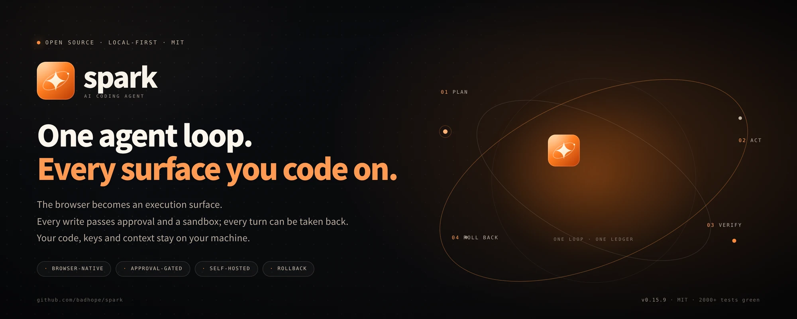</a>
</p>

<p align="center">
  <a href="https://github.com/badhope/spark/releases/latest"></a>
  
  
  
  <a href="https://github.com/badhope/spark/stargazers"></a>
  
</p>

<p align="center"><strong>Make the browser an execution surface. Put every step in a ledger you can roll back.</strong></p>

Spark is not a chat box bolted onto an editor. It folds the browser, terminal, desktop, IDE, phone and API into one agent loop — plans you can see, writes you can stop, and steps you can take back.

Most agents look limitless in a demo and fragile in a real repository. Spark is built for the second act: writes pass approval and a sandbox, tests are executed by the runner itself, and every turn leaves a checkpoint behind. Code, keys and context stay in the workspace you choose.

## Quickstart

```bash
# Linux / macOS — SHA256-verified installer
curl -fsSL https://raw.githubusercontent.com/badhope/spark/main/scripts/install.sh | sh

# Windows (PowerShell)
irm https://raw.githubusercontent.com/badhope/spark/main/scripts/install.ps1 | iex

spark init    # connect any OpenAI-compatible endpoint
spark web     # open the browser UI
```

No API key? Spark still starts, but reports the real configuration error instead of inventing an answer. Settings has an explicit **Mock demo mode** so you can inspect the interface first; live-mode errors (missing key, model not downloaded, unreachable endpoint) are shown as they are.

<p align="center">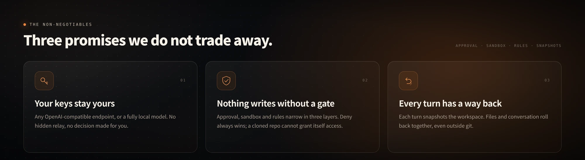</p>

## One loop, six surfaces

<p align="center">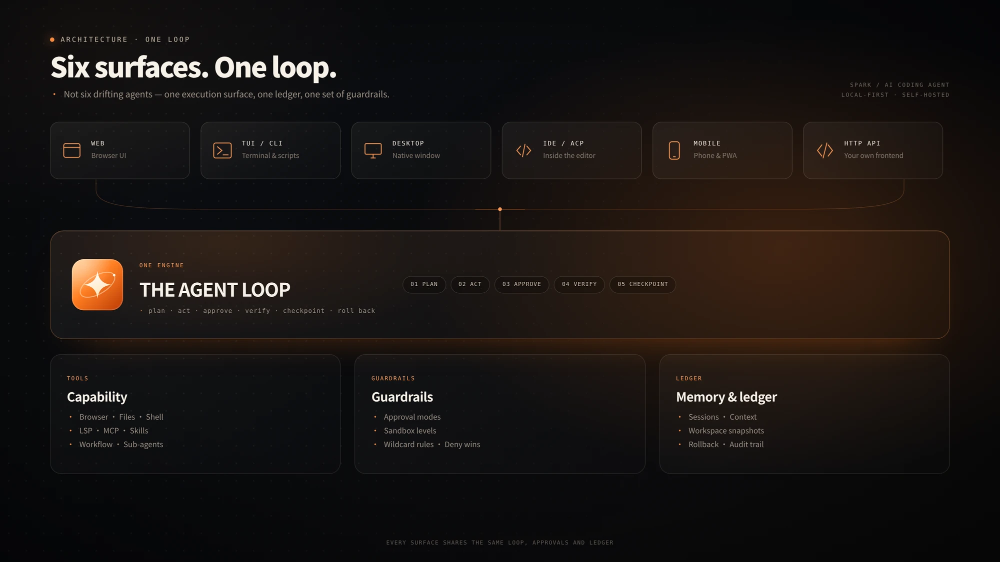</p>

Web, desktop, CLI/TUI, IDE/ACP, phone and HTTP API share the same `AgentLoop`, approvals, sandbox, rollback and ledger. They are not six drifting implementations. Switch surfaces and your rules and context do not start over.

### The browser is not an attachment

Browser automation runs on Playwright with Chromium / Chrome / Edge / Firefox / WebKit engines, persistent profiles for logged-in sessions, and CDP attachment to an already-running browser.

Its 24 `browser_*` tools cover snapshots, interaction, tabs, downloads, PDF, console, network, traces and Chromium metrics. Per-domain `allow/read/prompt/deny` rules gate writes, with a second confirmation on sensitive sites. Reusing a signed-in tab goes through the official Playwright MCP `--extension` preset; see [`docs/BROWSER_EXTENSION_BRIDGE.md`](docs/BROWSER_EXTENSION_BRIDGE.md).

### Nothing writes without a gate

Approval, sandbox and rules narrow in order. Wildcard rules are scoped to user, project and local config; `deny` always wins. Protected credential paths and shell token checks stay on. A cloned repository can tighten permissions, never grant itself more.

### Every turn has a way back

Each turn snapshots the workspace. Files and conversation restore together, even outside git. Tasks move as branches: start, commit each verified step, finish on green tests; a failed run abandons its branch instead of leaking changes into the main workspace.

### Models, tools and UI are yours

MIT licensed. Providers, tools, MCP servers, Skills, slash commands, plugins, themes and workflows are replaceable, and the whole stack can be self-hosted. Use any OpenAI-compatible endpoint, fallback model chain and credential pool, plus a separate small model for auxiliary calls.

When the task calls for real files, the enterprise control plane turns documents, meeting recordings and spreadsheets into cited minutes, action items, reports and exports; local OCR and transcription keep the source on your machine.

<p align="center">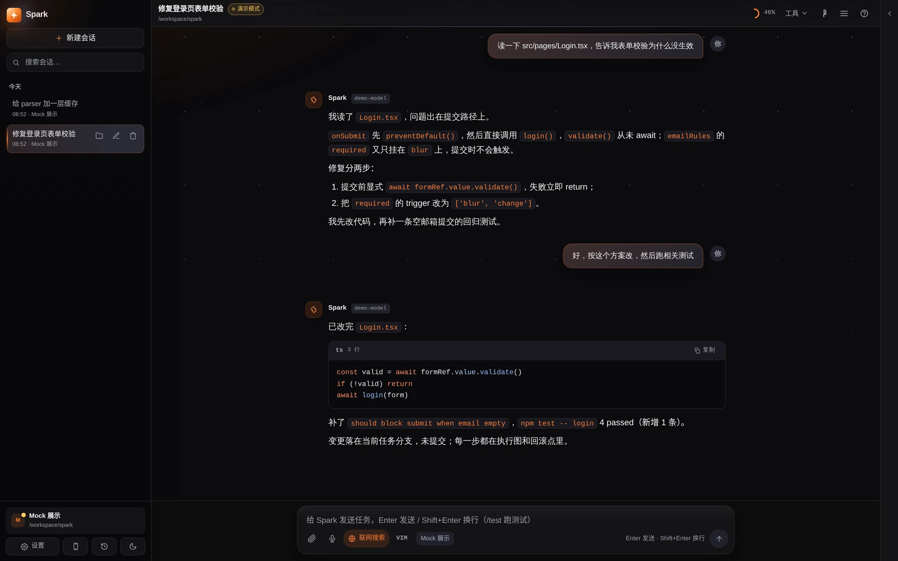</p>

<p align="center"><sub>The real interface: read a file → explain the root cause → change the code → run the tests. Reasoning, tool results and checkpoints live on one timeline.</sub></p>

## A real look

<p align="center">
  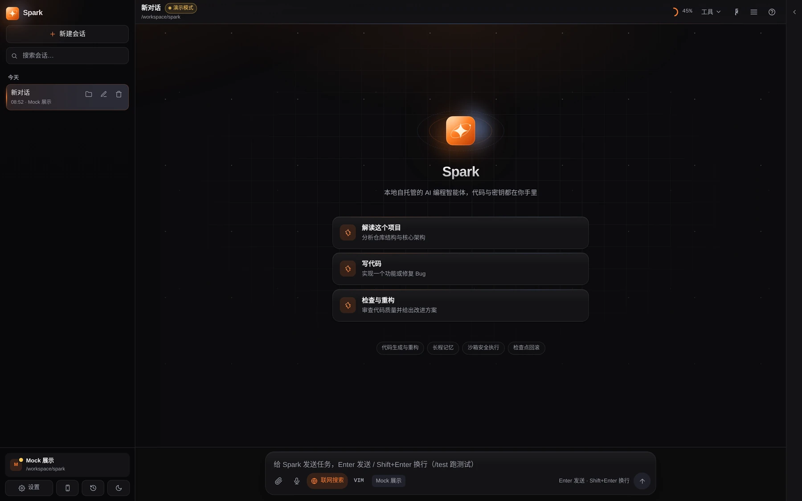
  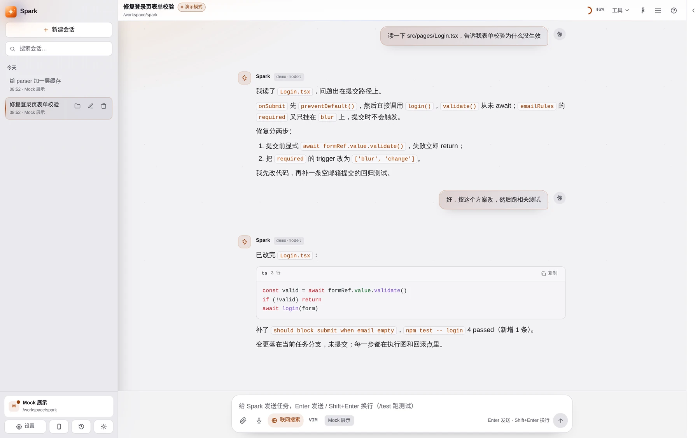
</p>

<p align="center"><sub><b>Dark</b> · the star field and orbit; <b>light</b> · the default skin for daylight coding.</sub></p>

<p align="center">
  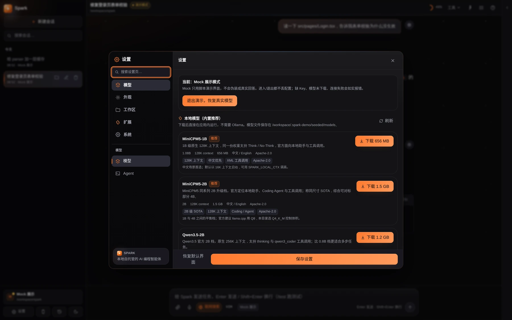
  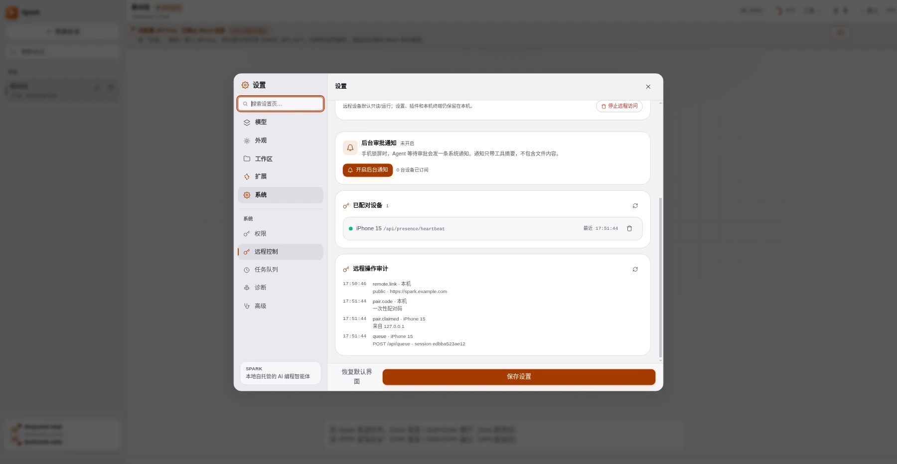
</p>

<p align="center"><sub><b>Settings</b> does not hide safety in a config file; <b>audit</b> keeps remote writes visible only on the host. The UI is bilingual; screenshots show the Chinese locale.</sub></p>

## Unattended, not unwatched

```bash
spark autopilot "add rate limiting to the auth module, with regression tests" --workdir .
spark autopilot --resume .spark/autopilot/<run-id>.json --workdir .   # continue after a stop
spark autopilot "refactor the parser" --workdir . --json              # NDJSON for CI/queues
```

Autopilot runs the same `AgentLoop`, approvals and sandbox as every other entry point. It adds a state machine around them:

1. **build** — read the repository, classify the task, plan, implement;
2. **repair** — feed the independent test failure back, classify the root cause, fix it;
3. **audit** — after tests are green, re-check requirement coverage and boundaries;
4. **done** — only when tests pass, a real diff exists, and the audit turn finished.

Each turn is persisted to `.spark/autopilot/<run-id>.json`; an in-flight turn is marked with `turn_in_progress`, `active_prompt`, `pid` and retried on `--resume` instead of being skipped.

`--heartbeat-interval` touches the state file during long model calls, and no-progress uses three fingerprints (diff, test output, tool calls). `--max-turns`, `--turn-timeout`, `--task-timeout`, `--max-cost-usd` and consecutive no-progress limits stop a runaway run. The default is `full-auto` + workspace sandbox + no tool network; `unrestricted` requires `--allow-unrestricted`. Tests are executed by the runner itself, never accepted from the model's "done" claim. See [`docs/AUTOPILOT.md`](docs/AUTOPILOT.md) for the state machine, prompt contract and honest limits.

<p align="center">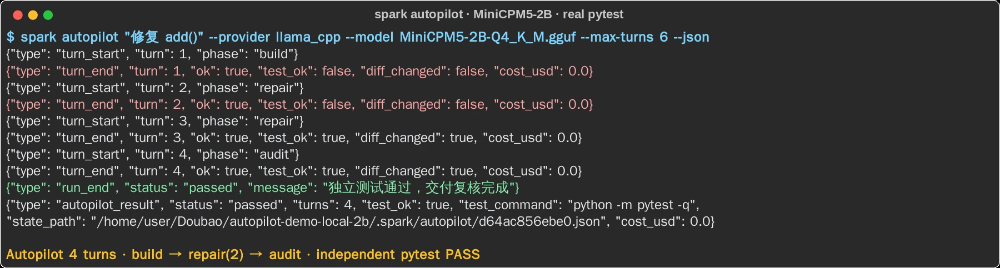</p>

<p align="center"><sub>This image was rendered from the actual NDJSON log of the run, not a mockup.</sub></p>

## Your desktop is the host, your phone is the remote

Open **Settings → System → Remote control** and generate a one-time link and QR code. The phone joins the same workspace; files, commands, model calls and approvals still run on the desktop. Same Wi-Fi works with `spark web --host 0.0.0.0`; public access uses `spark web --public-url https://your-domain` behind your own HTTPS reverse proxy.

The phone can chat, approve, cancel, switch sessions and read files and diffs. Settings, plugins and direct shell/PTY stay local. Pairing codes expire after 5 minutes; each device gets its own 7-day token that can be revoked independently. Paired pages show live presence and a local-only audit trail of remote writes; an HTTPS or localhost page can enable Web Push so a locked phone still receives approval alerts.

The phone gets its own home instead of a shrunken desktop: at 390×844 the first screen shows pending approvals, the current session and a new task, with a fixed four-item tab bar. Approvals take two taps — review on the home card, then allow or deny. It is installable as a PWA; the composer microphone uses browser `SpeechRecognition` and falls back to the keyboard when unsupported or denied.

<p align="center">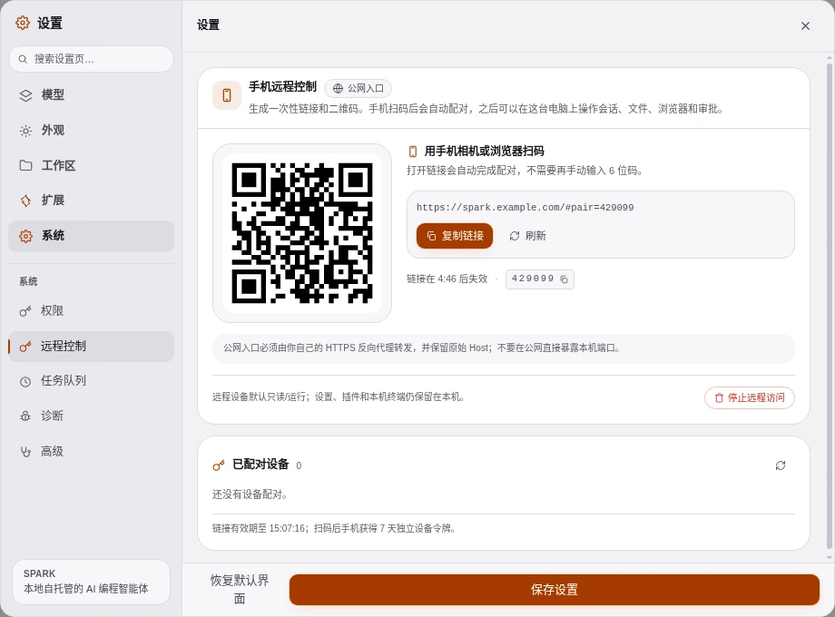</p>

<p align="center">
  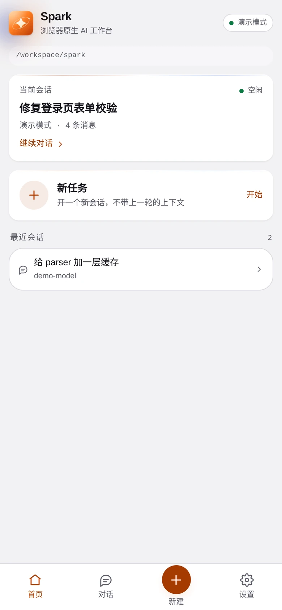
  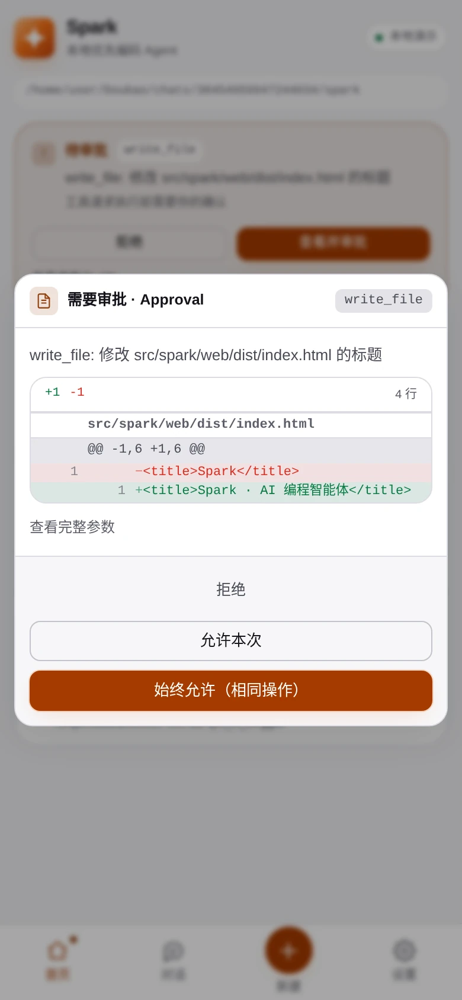
</p>

<p align="center"><sub>Pairing, presence, audit and two-tap approvals all live inside the same permission model.</sub></p>

## Safety model

Three layers, each narrower than the last:

1. **Approval** — from plan-only to full-auto. The default asks before writes and commands.
2. **Sandbox** — workspace isolation by default; escapes and protected paths are refused.
3. **Rules** — tool and resource matching across user, project and local scopes. A cloned repository can tighten permissions, never grant itself more.

OS-level isolation is used where available: bwrap on Linux, Job Objects on Windows, `sandbox-exec` on macOS. When a platform cannot enforce a control, the tool result says so instead of pretending.

## Interfaces and commands

| Interface | Command | Use it for |
|---|---|---|
| Web UI | `spark web` | Chat, files, terminal, execution graph |
| Enterprise API | `spark enterprise` | `/api/v1` control plane and `/office` |
| Desktop | `spark desktop` | Native window, loopback only |
| TUI / CLI | `spark` · `spark exec --json` | Terminal work and automation |
| IDE / ACP | `spark acp` · `spark ide install` | Zed, JetBrains, Neovim |
| MCP / A2A | `spark mcp-serve` · `spark a2a-serve` | Tool and agent-to-agent integration |

```bash
spark                         # terminal TUI
spark web                     # browser UI on loopback
spark web --host 0.0.0.0      # LAN; Settings → Remote generates a QR link
spark web --public-url https://spark.example.com  # behind your HTTPS reverse proxy
spark desktop                 # native window, loopback only
spark exec "task" --json      # NDJSON events for scripts and CI
spark review                  # inspect the uncommitted diff
spark doctor                  # check config, credentials and runtime
spark browser-doctor          # launch the configured engine and render a test page
```

`spark exec` emits one JSON object per line and ends with `{"type":"final","text":"…"}`, so it pipes directly into `jq`. The enterprise control plane also provides document and meeting workflows:

```bash
spark enterprise --host 127.0.0.1 --port 18800
# http://127.0.0.1:18800/office
```

## OpenCode compatibility

```bash
spark opencode --workdir .        # inspect config, agents, commands, MCP and parse errors
spark opencode --workdir . --json # machine-readable
```

Spark reads `opencode.json(c)`, `.opencode/agents/**/*.md`, `.opencode/commands/*.md` and inline `command` entries; `permission` / `permissions` deny maps to tool denylists. It does not implement the OpenCode plugin runtime, provider registry, automatic MCP import, or ``!`command` `` shell injection; those are not silently faked. See [`docs/OPENCODE_COMPAT.md`](docs/OPENCODE_COMPAT.md).

## Documentation

| Doc | 中文 |
|---|---|
| [Project baseline](docs/PROJECT_BASELINE.md) | [项目基线](docs/PROJECT_BASELINE.md) |
| [Autopilot](docs/AUTOPILOT.md) | [Autopilot](docs/AUTOPILOT.md) |
| [OpenCode compatibility](docs/OPENCODE_COMPAT.md) | [OpenCode 兼容](docs/OPENCODE_COMPAT.md) |
| [Product positioning](docs/en/PRODUCT_POSITIONING.md) | [产品定位](docs/PRODUCT_POSITIONING.md) |
| [Core capability gaps](docs/CORE_CAPABILITY_GAPS.md) | [核心能力差距](docs/CORE_CAPABILITY_GAPS.md) |
| [Integration map](docs/INTEGRATION_MAP.md) | [外部集成地图](docs/INTEGRATION_MAP.md) |
| [Install & build](docs/en/INSTALL.md) | [安装与打包](docs/INSTALL.md) |
| [Configuration](docs/en/CONFIG.md) | [配置](docs/CONFIG.md) |
| [HTTP API](docs/en/API.md) | [API](docs/API.md) |
| [Architecture](docs/en/ARCHITECTURE.md) | [架构](docs/ARCHITECTURE.md) |
| [Features](docs/FEATURES.md) | [功能总览](docs/FEATURES.md) |
| [Remote control](docs/REMOTE.md) | [远程控制](docs/REMOTE.md) |
| [Enterprise control plane](docs/ENTERPRISE.md) | [企业控制面](docs/ENTERPRISE.md) |
| [A2A protocol](docs/A2A.md) | [A2A](docs/A2A.md) |
| [ACP / IDE setup](docs/ACP.md) | [IDE 接入](docs/ACP.md) |

More: [docs index](docs/README.md) · [English docs](docs/en/README.md) · [VS Code extension](vscode-spark/README.md) · [audit notes](docs/reviews/) · [brand guide](brand/README.md).

## Verify locally

```bash
pytest -q
ruff check src tests scripts
mypy src/spark --ignore-missing-imports
```

CI also runs a Windows checkout check, frontend build drift, packaging checks, a secret scan, an OpenAPI snapshot check and a mock-mode agent eval.

## Requirements

Python 3.11.5+ (or the bundled executable), Node.js 18+ only for frontend development, Windows / macOS / Linux.

If Spark saves you a context switch, leave a star so the next person who needs it can find it.

---

**License:** MIT · **Author:** badhope
