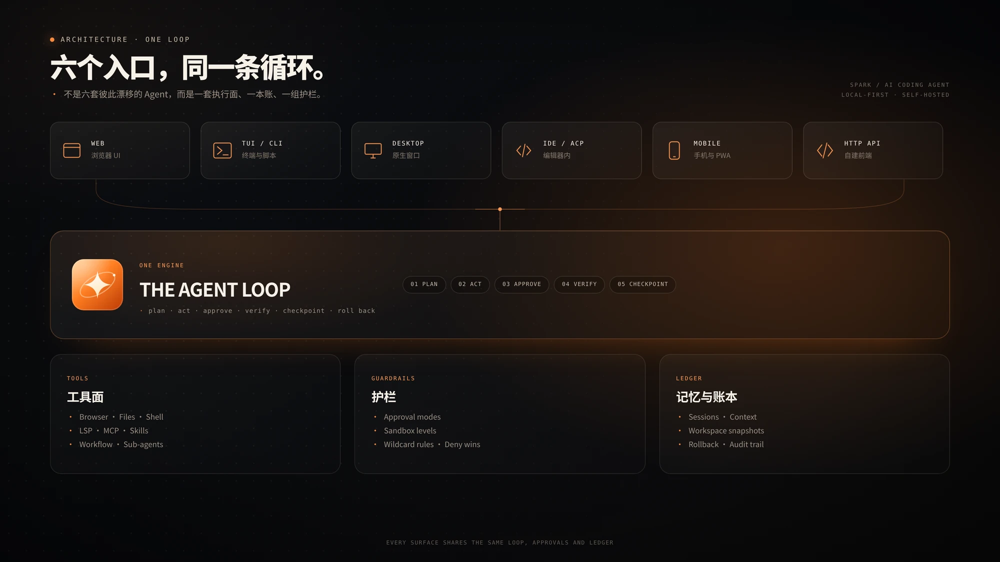
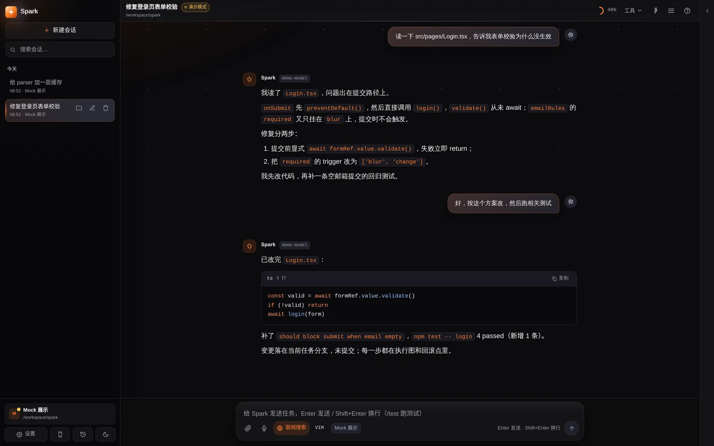
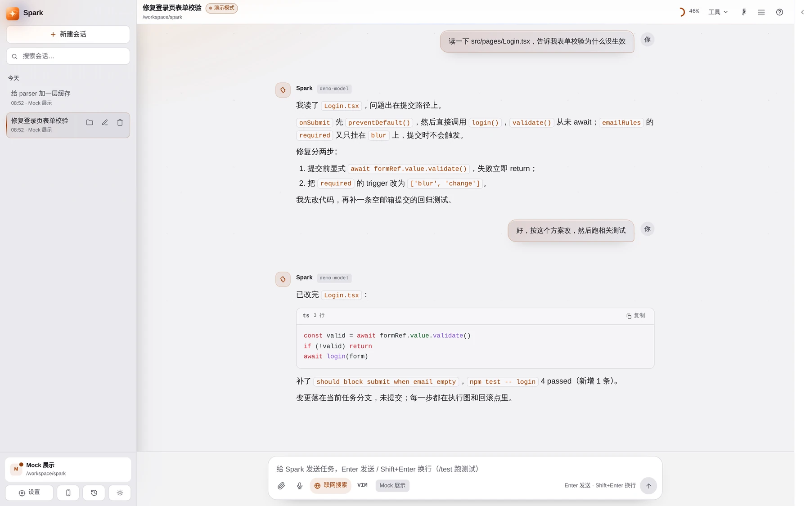
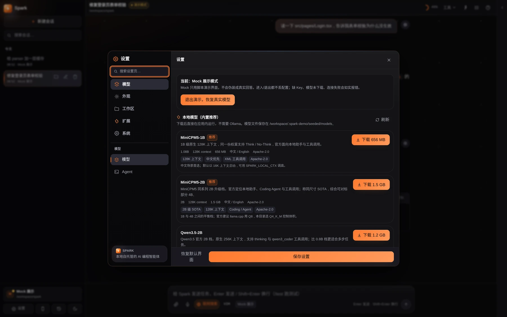
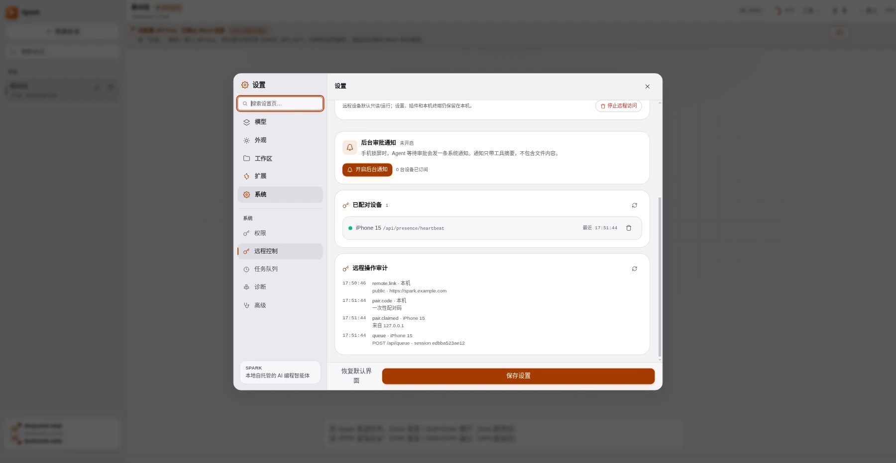
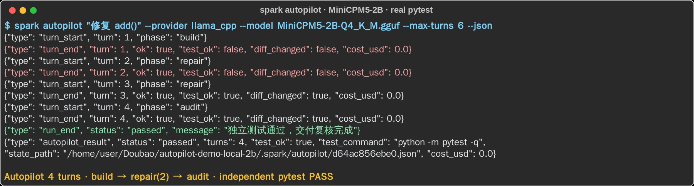
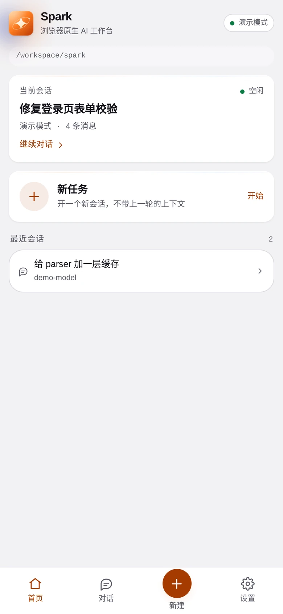
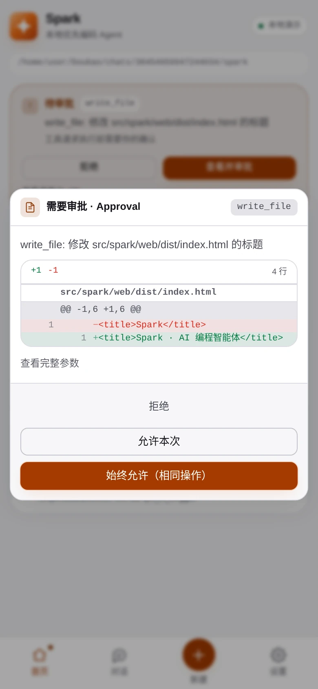

> [English](README.md) | **中文**

<p align="center">
  <a href="https://github.com/badhope/spark/releases/latest"></a>
</p>

<p align="center">
  <a href="https://github.com/badhope/spark/releases/latest"></a>
  
  
  
  <a href="https://github.com/badhope/spark/stargazers"></a>
  
</p>

<p align="center"><strong>把浏览器变成执行面，把每一步写进可回滚的账本。</strong></p>

Spark 不是把聊天框钉在编辑器旁边。它把浏览器、终端、桌面、IDE、手机与 API 收进同一条 Agent 循环：看得见计划，拦得住写入，退得回每一步。

在真实仓库里，“已完成”不能靠模型自述。Spark 让写入先过审批与沙箱，测试由运行器自己跑，每个回合都留快照。代码、密钥与上下文，默认留在你指定的工作区。

## 三十秒，先把它跑起来

```bash
# Linux / macOS —— 一行安装，SHA256 校验
curl -fsSL https://raw.githubusercontent.com/badhope/spark/main/scripts/install.sh | sh

# Windows（PowerShell）
irm https://raw.githubusercontent.com/badhope/spark/main/scripts/install.ps1 | iex

spark init    # 配置任意 OpenAI 兼容端点
spark web     # 打开浏览器界面
```

第一次运行 `spark init`；没有 API Key 也能启动。Spark 会如实显示配置错误，设置页提供显式的「Mock 展示模式」，让你先看清界面，但不生成假回答。

<p align="center"></p>

## 一条循环，六个入口

<p align="center"></p>

Web、桌面、CLI/TUI、IDE/ACP、手机与 HTTP API 共用同一套 `AgentLoop`、审批、沙箱、回滚与账本。它们不是六套彼此漂移的实现，换一个入口，规则和上下文不会重来一遍。

### 浏览器不是附件，是执行面

浏览器自动化基于 Playwright，可切 Chromium / Chrome / Edge / Firefox / WebKit，可用持久化 Profile 复用登录态，也可通过 CDP 接管已经运行的浏览器。

24 个 `browser_*` 工具覆盖 snapshot、交互、标签页、下载、PDF、控制台、网络、trace 与 Chromium 性能指标；按域名 `allow/read/prompt/deny` 授权，敏感站点的写操作默认二次确认。要复用已登录标签页，走官方 Playwright MCP `--extension` 预设，见 [`docs/BROWSER_EXTENSION_BRIDGE.md`](docs/BROWSER_EXTENSION_BRIDGE.md)。

### 写入之前，先过闸门

审批、沙箱、规则三层逐级收窄。通配规则覆盖 user / project / local 三个作用域，`deny` 始终优先；凭据路径保护与 shell token 检查保持开启。克隆下来的仓库只能收紧权限，不能给自己放行。

### 错了，就退回去

每个回合快照工作区，文件与对话可以一起恢复，非 git 目录同样有效。任务按分支推进：开始、逐步提交、绿测后收尾；失败的运行会放弃分支，不把改动泄漏到主工作区。

### 模型、工具与界面，都可以换

MIT 开源，Provider、工具、MCP、Skills、命令、插件、主题与工作流都可替换，也可整套自托管。任意 OpenAI 兼容端点、fallback 模型链、凭据池，以及独立的小模型承担辅助调用。

需要处理真实文件时，企业控制面可把文档、会议录音和表格变成带来源行号的纪要、行动项、报告与导出；本地 OCR 与转写让原始资料留在机器上。

<p align="center"></p>

<p align="center"><sub>真实界面：读文件 → 解释根因 → 改代码 → 跑测试。推理、工具结果与回滚点都在同一条时间线上。</sub></p>

## 先看一眼真实的屏幕

<p align="center">
  
  
</p>

<p align="center"><sub><b>暗色</b> · 星图与轨道；<b>亮色</b> · 白天写代码的默认肤色。</sub></p>

<p align="center">
  
  
</p>

<p align="center"><sub><b>设置</b> 不把安全藏进配置文件；<b>审计</b> 只在本机留下远程写记录。</sub></p>

## 无人值守，不等于无人看管

```bash
spark autopilot "给 auth 模块加请求频率限制，并补回归测试" --workdir .
spark autopilot --resume .spark/autopilot/<run-id>.json --workdir .   # 中断后继续
spark autopilot "重构 parser" --workdir . --json                      # 给 CI/队列的 NDJSON
```

Autopilot 复用同一个 `AgentLoop`、审批和沙箱，只在外面加状态机：

1. **build**：读仓库、判断场景、给计划、开始实现；
2. **repair**：把独立测试的失败输出原样回灌，按根因修；
3. **audit**：测试绿了以后复核需求覆盖与边界；
4. **done**：测试通过 + 有真实 diff + 复核完成才交付。

每轮状态写入 `.spark/autopilot/<run-id>.json`；进行中的轮次会先写 `turn_in_progress`、`active_prompt`、`pid`，`--resume` 识别为中断轮并重试，不跳过。

`--heartbeat-interval` 在长模型调用期间更新状态文件 mtime；无进展按 diff、测试输出、工具调用三路指纹判断。`--max-turns`、`--turn-timeout`、`--task-timeout`、`--max-cost-usd` 和连续无进展熔断会停掉失控运行。默认 `full-auto` + workspace 沙箱 + 工具无网络；`unrestricted` 必须显式 `--allow-unrestricted`。测试由运行器自己执行，不采信模型自述“已完成”。边界与未验证项见 [`docs/AUTOPILOT.md`](docs/AUTOPILOT.md)。

<p align="center"></p>

<p align="center"><sub>这张图由一次真实运行的 NDJSON 日志渲染，不是设计稿。</sub></p>

## 电脑是主机，手机是遥控器

打开 **设置 → 系统 → 远程控制**，生成一次性链接和二维码。手机接入的是同一个工作区；文件、命令、模型调用和审批仍在电脑上执行。同一 Wi‑Fi 用 `spark web --host 0.0.0.0`；外网用 `spark web --public-url https://你的域名`，前面挂自己的 HTTPS 反向代理。

手机能发消息、审批、取消、切换会话、看文件和 diff；设置、插件、直接 shell/PTY 仍留在本机。配对码 5 分钟有效，每台设备拿独立的 7 天令牌，可单独吊销。设备列表带在线状态和仅本机可见的远程写审计；HTTPS 或 localhost 页面可开启 Web Push，锁屏时也能收到审批通知。

手机端是独立首页，不是把桌面布局缩窄：390×844 首屏固定显示待审批、当前会话与新任务，底部四栏导航始终可见；审批在首页卡片点“查看并审批”后再点允许/拒绝，两步完成。支持加入主屏幕（PWA）；输入框的麦克风走浏览器 `SpeechRecognition`，浏览器不支持或权限被拒时提示并回到键盘输入。

<p align="center"></p>

<p align="center">
  
  
</p>

<p align="center"><sub>配对、在线状态、审计与两步审批，都在同一套权限里。</sub></p>

## 安全模型

三层权限逐级收窄：

1. **审批** —— 从 plan-only 到 full-auto；默认模式在写入和命令前询问。
2. **沙箱** —— 默认工作区隔离，越界路径与受保护路径直接拒绝。
3. **规则** —— 按“工具 + 资源”匹配，覆盖 user / project / local 三个作用域；克隆下来的仓库只能收紧权限，不能给自己放行。

平台支持时再叠加 OS 级隔离：Linux 用 bwrap，Windows 用 Job Object，macOS 用 `sandbox-exec`。平台做不到的能力会如实写进工具结果，而不是假装有。

## 界面与命令

| 界面 | 命令 | 用途 |
|---|---|---|
| Web UI | `spark web` | 对话、文件、终端、执行图 |
| 企业 API | `spark enterprise` | `/api/v1` 控制面与 `/office` |
| 桌面 | `spark desktop` | 原生窗口，仅回环 |
| TUI / CLI | `spark` · `spark exec --json` | 终端工作与自动化 |
| IDE / ACP | `spark acp` · `spark ide install` | Zed、JetBrains、Neovim |
| MCP / A2A | `spark mcp-serve` · `spark a2a-serve` | 工具与 Agent 间协作 |

```bash
spark                         # 终端 TUI
spark web                     # 浏览器界面，仅回环
spark web --host 0.0.0.0      # 局域网；设置→远程控制生成二维码链接
spark web --public-url https://spark.example.com  # 放在自己的 HTTPS 反向代理后
spark desktop                 # 原生窗口，仅回环
spark exec "任务" --json       # NDJSON 事件流，适合脚本与 CI
spark review                  # 审查未提交的 diff
spark doctor                  # 体检配置、凭据与运行时
spark browser-doctor          # 真实启动当前浏览器引擎并渲染测试页
```

`spark exec` 每行输出一个 JSON 事件，最后以 `{"type":"final","text":"…"}` 收尾，可直接接 `jq`。企业控制面还提供文档与会议工作流：

```bash
spark enterprise --host 127.0.0.1 --port 18800
# http://127.0.0.1:18800/office
```

## OpenCode 兼容

```bash
spark opencode --workdir .        # 查看配置、Agent、命令、MCP 与解析错误
spark opencode --workdir . --json # 机器可读
```

已兼容 `opencode.json(c)`、`.opencode/agents/**/*.md`、`.opencode/commands/*.md` 与内联 `command`；`permission`/`permissions` 的 deny 会映射为工具禁用清单。不支持插件运行时、provider 注册表、MCP 自动导入与 ``!`command` `` shell 注入，不伪装支持。详见 [`docs/OPENCODE_COMPAT.md`](docs/OPENCODE_COMPAT.md)。

## 文档

| 英文 | 中文 |
|---|---|
| [Project baseline](docs/PROJECT_BASELINE.md) | [项目基线](docs/PROJECT_BASELINE.md) |
| [Autopilot](docs/AUTOPILOT.md) | [Autopilot](docs/AUTOPILOT.md) |
| [OpenCode compatibility](docs/OPENCODE_COMPAT.md) | [OpenCode 兼容](docs/OPENCODE_COMPAT.md) |
| [Product positioning](docs/en/PRODUCT_POSITIONING.md) | [产品定位](docs/PRODUCT_POSITIONING.md) |
| [Core capability gaps](docs/CORE_CAPABILITY_GAPS.md) | [核心能力差距](docs/CORE_CAPABILITY_GAPS.md) |
| [Integration map](docs/INTEGRATION_MAP.md) | [外部集成地图](docs/INTEGRATION_MAP.md) |
| [Install & build](docs/en/INSTALL.md) | [安装与打包](docs/INSTALL.md) |
| [Configuration](docs/en/CONFIG.md) | [配置](docs/CONFIG.md) |
| [HTTP API](docs/en/API.md) | [API](docs/API.md) |
| [Architecture](docs/en/ARCHITECTURE.md) | [架构](docs/ARCHITECTURE.md) |
| [Features](docs/FEATURES.md) | [功能总览](docs/FEATURES.md) |
| [Remote control](docs/REMOTE.md) | [远程控制](docs/REMOTE.md) |
| [Enterprise control plane](docs/ENTERPRISE.md) | [企业控制面](docs/ENTERPRISE.md) |
| [A2A protocol](docs/A2A.md) | [A2A](docs/A2A.md) |
| [ACP / IDE setup](docs/ACP.md) | [IDE 接入](docs/ACP.md) |

更多：[文档索引](docs/README.md) · [English docs](docs/en/README.md) · [VS Code 扩展](vscode-spark/README.md) · [审计记录](docs/reviews/) · [品牌规范](brand/README.md)。

## 本地验证

```bash
pytest -q
ruff check src tests scripts
mypy src/spark --ignore-missing-imports
```

CI 另外跑 Windows 保留路径检查、前端构建漂移、打包检查、密钥扫描、OpenAPI 快照检查，以及 mock 模式 Agent 评测。

## 运行要求

Python 3.11.5+（或直接使用打包产物），Node.js 18+ 仅用于前端开发，支持 Windows / macOS / Linux。

如果 Spark 帮你省下一次上下文切换，留一颗星，让下一个需要它的人找到这里。

---

**License:** MIT · **Author:** badhope
