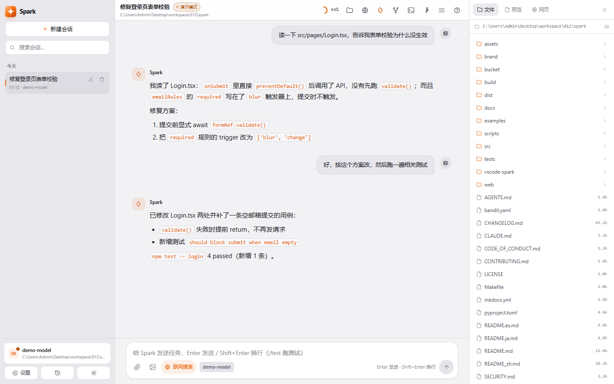
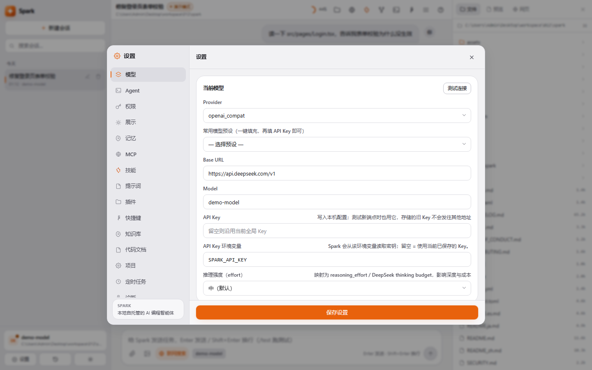
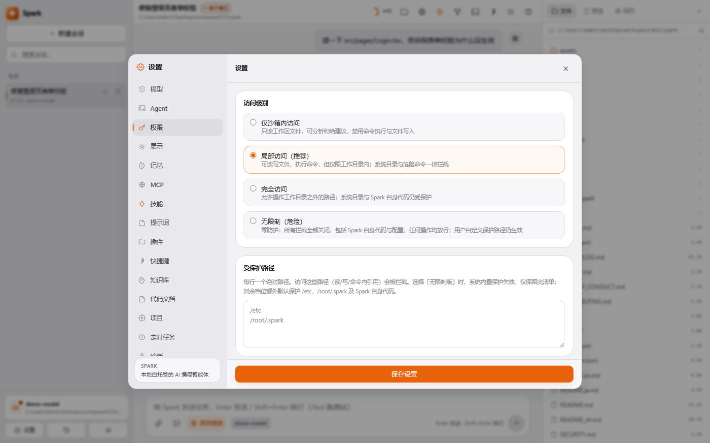
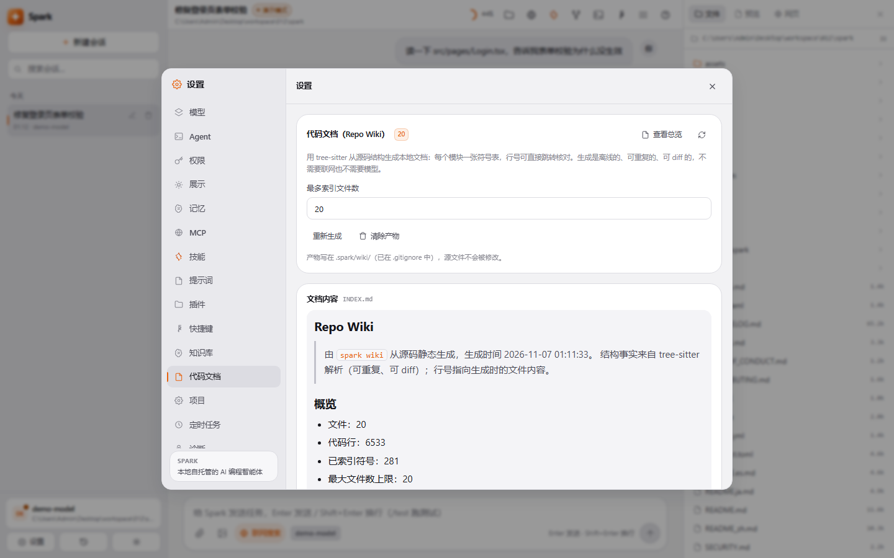
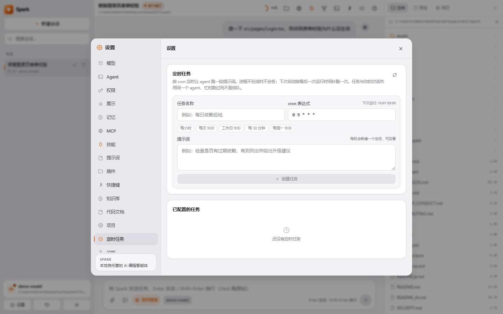
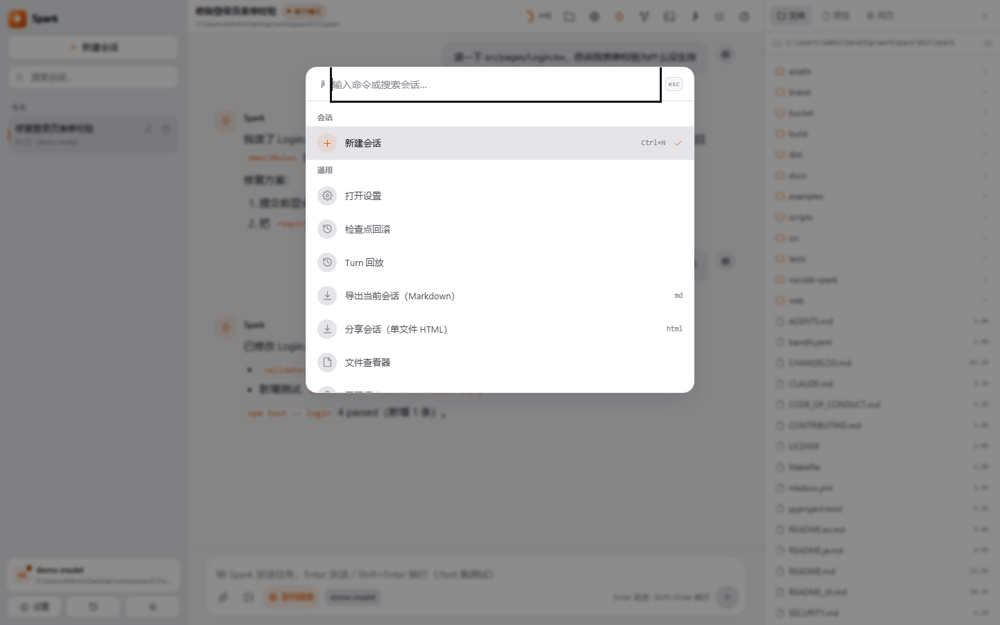

> 🌐 [English](README.md) | **中文**

# Spark

**本地优先的 AI 编程智能体，护栏可审计。**

[](https://opensource.org/licenses/MIT)
[](https://www.python.org/)
[](https://nodejs.org/)
[](https://github.com/badhope/spark/actions/workflows/ci.yml)
[](https://github.com/badhope/spark/actions/workflows/security.yml)

审批、三平台沙箱、检查点回滚、供应商韧性都是**设计进去的**，不是事后补的。
同一套 agent loop 跑七种形态；自带任意 OpenAI 兼容端点，无账号、无遥测、无厂商锁定。

```bash
# Linux / macOS —— 一行安装，SHA256 校验
curl -fsSL https://raw.githubusercontent.com/badhope/spark/main/scripts/install.sh | sh

# Windows（PowerShell）
irm https://raw.githubusercontent.com/badhope/spark/main/scripts/install.ps1 | iex

spark init    # 配置任意 OpenAI 兼容端点
spark web     # 打开界面（自动挑空闲端口）
```

没有 API Key 时进入 **演示模式**（mock 模型）；在设置里填入密钥后下一轮就走真实模型，无需重启。

<p align="center">
  
</p>

---

## 它替你解决什么

| | |
|---|---|
| **七种形态，一个大脑** | Web UI · 桌面窗口 · Textual TUI · 可脚本化 CLI · ACP（Zed 等）· MCP Server · A2A Server。同一套循环、同一套工具、同一套权限。 |
| **审批可审计** | 六档审批 × 四档沙箱；通配规则引擎，`deny` 跨 user/project/local 作用域优先；凭据路径保护；token 级 shell 检查。 |
| **回滚不靠运气** | 每个回合快照工作区（tar.gz + manifest 校验）。文件与对话可一起回滚，非 git 目录同样有效。 |
| **任务即分支** | `task_begin` → `task_step_commit` → `task_finish`。绿测才允许提交，失败自动废弃分支——是一等工具，不是演示。 |
| **AI 审 AI** | `spark review` 在强制只读、仅沙箱的回合里审查 diff，输出按严重度分级的问题；`--json` 直接进 CI。 |
| **供应商韧性** | 凭据池失败轮换、模型降级链、独立小模型承担辅助调用。一把 key 用尽不会阻断整轮对话。 |
| **带治理的记忆** | AGENTS.md 三级层级（全局 + 项目 + 嵌套）+ 向量长期记忆，去重合并、容量淘汰，全部可在界面管理。 |

## 界面实拍

**设置 · 模型。** 任意 OpenAI 兼容端点、可保存的模型档案、真实连通性探测、三档推理强度映射到供应商原生参数。



**设置 · 权限与沙箱。** 四档访问级别，每档都有明确的行为说明；受保护路径列表用户可编辑，`.git/hooks`、`~/.spark` 与 Spark 自身源码始终受保护。



**设置 · 代码文档。** 从源码结构生成可追溯的项目手册：每个模块一张符号表、行号为真实解析结果、增量重建；不需要联网，也不需要模型。



**定时任务。** cron 触发的提示词与对话共用同一个 agent；进程离线期间错过的任务在下次启动补跑一次，忙碌时跳过而不排队。



**命令面板。** `Ctrl+K` 模糊跳转所有界面：新会话、检查点、回合回放、文件查看、网页阅读、分享导出、主题、语言。



## 快速上手

```bash
spark                         # 终端 TUI
spark web                     # 浏览器界面，绑定 127.0.0.1（自动选端口）
spark desktop                 # 原生窗口，仅回环
spark exec "任务" --json       # NDJSON 事件流，适合脚本与 CI
spark review                  # 审查未提交的 diff
spark wiki --refresh          # 重新生成代码文档
spark doctor                  # 体检配置、凭据、运行时
spark uninstall --list        # 先看清单再决定是否卸载
```

`spark exec` 每行一个 JSON 事件，最后一行是 `{"type":"final","text":"…"}`，可直接接 `jq`。

## 七种形态

| 形态 | 命令 | 场景 |
|---|---|---|
| Web UI | `spark web` | 日常对话、文件查看、终端、执行图 |
| 桌面 | `spark desktop` | 原生 pywebview 窗口，仅回环 |
| TUI | `spark` | 纯终端 / SSH |
| CLI | `spark exec "任务" --json` | 自动化、CI、管道 |
| IDE（ACP） | `spark acp` | Zed 等 ACP 客户端 —— [docs/ACP.md](docs/ACP.md) |
| MCP Server | `spark mcp-serve` | 把全部内置工具暴露给其它 MCP 客户端 |
| A2A Server | `spark a2a-serve` | Agent 间委派 —— [docs/A2A.md](docs/A2A.md) |

## 三层护栏如何收窄

1. **审批** —— 六档，从 `plan-only`（只出计划、不改任何东西）到 `full-auto`。默认 `suggest`：写文件与执行命令都要先确认。
2. **沙箱** —— `sandbox-only` / `workspace`（默认）/ `full-access` / `unrestricted`。越界路径与受保护路径一律拒绝。
3. **规则** —— `[[permission_rules]]` 按"工具 + 资源"匹配，三个作用域内 `deny` 优先，所以克隆下来的仓库只能收紧权限、无法给自己放行。

OS 级隔离叠在最上层：Linux 用 bwrap，Windows 用 Job Object（进程树 kill-on-close + 内存上限），macOS 用 `sandbox-exec`。平台做不到的能力会如实写进工具结果，而不是假装有。

## 本地验证，而不只在 CI 里绿

```bash
pytest -q                                  # 约 1400 条
ruff check src tests scripts
mypy src/spark --ignore-missing-imports
bandit -r src/spark -ll -ii -c bandit.yaml
lint-imports                               # 5 条架构契约
```

CI 另外跑密钥扫描（gitleaks + trufflehog）、OpenAPI 快照新鲜度、覆盖率下限、Windows 保留路径检查、打包检查，以及 mock 模式的 agent 评测套件，覆盖 Linux 与 Windows。

## 文档

| 文档 | 内容 |
|---|---|
| [docs/INSTALL.md](docs/INSTALL.md) | 安装、打包、桌面构建、自动更新、卸载 |
| [docs/CONFIG.md](docs/CONFIG.md) | 全部配置项与环境变量 |
| [docs/API.md](docs/API.md) | HTTP API 与 SSE 事件协议 |
| [docs/ARCHITECTURE.md](docs/ARCHITECTURE.md) | 分层与模块边界 |
| [docs/FEATURES.md](docs/FEATURES.md) | 逐项功能与代码落点 |
| [docs/A2A.md](docs/A2A.md) | A2A Agent Card、流式与任务生命周期 |
| [docs/competitive-comparison.md](docs/competitive-comparison.md) | 与 Qoder / ZCode / opencode / Codex CLI 的对比 |
| [docs/reviews/](docs/reviews/) | 审计报告：问题、修复与诚实的边界 |
| [vscode-spark/](vscode-spark/) | VS Code 扩展 |

## 平台要求

- Python 3.11+，或直接使用打包好的可执行文件（无需 Python）
- Node.js 18+ 仅用于前端开发（发行版自带编译产物）
- Windows / macOS / Linux

---

**License:** MIT · **Author:** badhope
