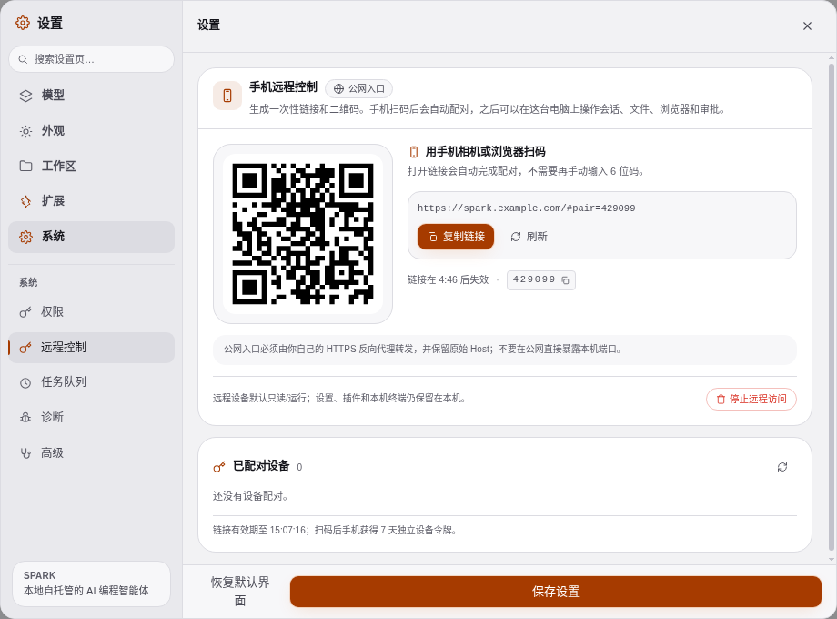
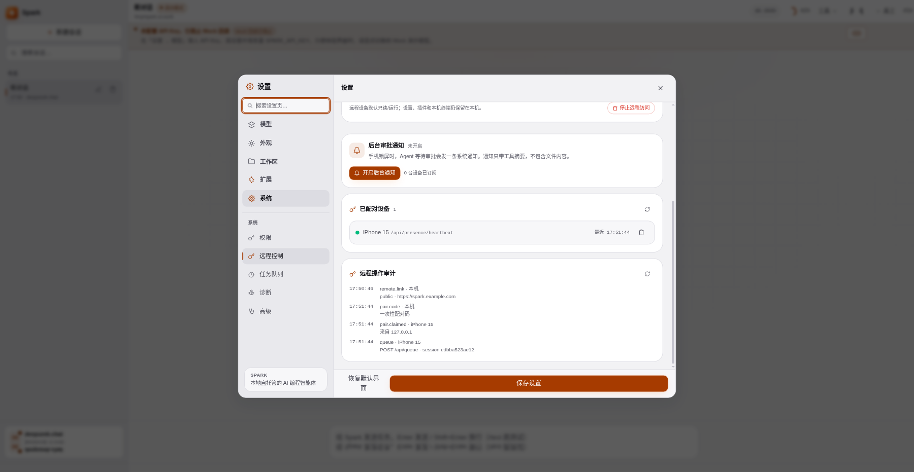
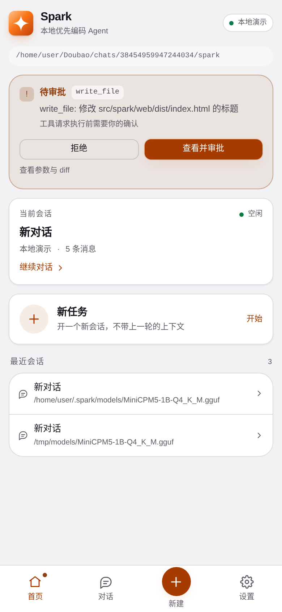
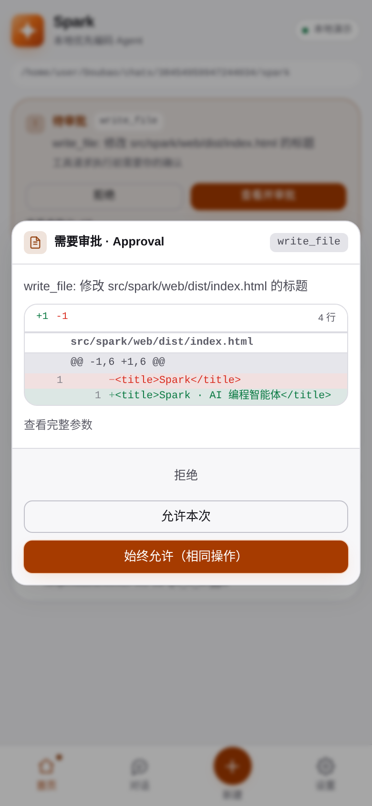
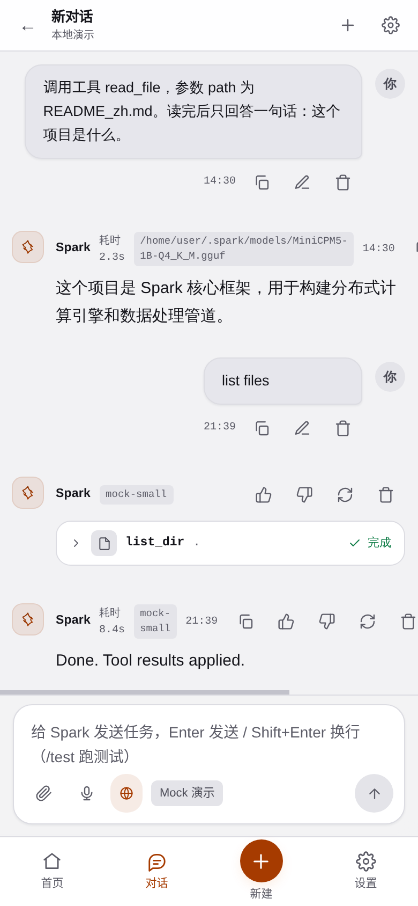
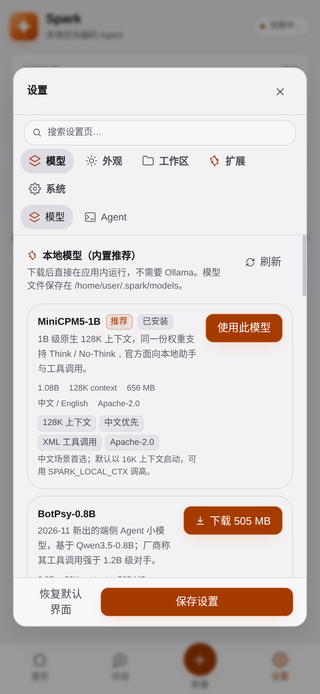

# 远程控制

手机扫码接入当前 Spark 工作区。桌面进程仍是运行时：文件、终端、模型和审批都在原机器上执行；手机只是把同一个工作台带到手上。





## 手机端形态

宽度小于 768px 时不再渲染桌面壳（`Sidebar + Header + ChatView + RightPanel`），切换为独立 `MobileShell`：

- 首屏固定显示待审批、当前会话和新任务；待审批卡片可直接拒绝，或点“查看并审批”进入详情后允许，两步完成。
- 底部固定首页 / 对话 / 新建 / 设置四栏，使用 `100dvh` 与 `safe-area-inset-bottom`，不遮住输入框。
- 对话页复用现有 SSE、会话租约和 `Composer`；普通访问也会注册 PWA `sw.js`，可加入主屏幕。
- 输入框麦克风走浏览器 `SpeechRecognition`；不支持、权限被拒或无结果时提示，并保留键盘输入。









## 三种入口

| 模式 | 适用场景 | 链接 |
|---|---|---|
| 本机 | 同一台电脑，浏览器调试 | 只监听 `127.0.0.1`，不生成可扫码链接 |
| 局域网 | 手机和电脑在同一 Wi‑Fi | `http://<局域网 IP>:<端口>/#pair=<6 位码>` |
| 公网 | 在外网操作家里的电脑 | `https://你的域名/#pair=<6 位码>`，由你自己的 HTTPS 反向代理转发 |

局域网二维码在点击“生成二维码”时按需开启临时监听，不会随 `spark web` 默认启动。公网模式需要启动时声明入口：

```bash
spark web --public-url https://spark.example.com
# 或
SPARK_PUBLIC_URL=https://spark.example.com spark web
```

只接受 `scheme://host[:port]`，不能带路径、查询参数或账号密码。如果走反向代理，必须保留原始 `Host`，并把 WebSocket/SSE 长连接一并转发。

### 用出站 relay 代替入站反向代理

不想在 Spark 机器上开入站端口时，可以让 relay 直接把 Web 挂到根路径；relay 与 agent 使用同一组 channel/key，浏览器只访问 relay，不接触 relay key：

```bash
# 有公网域名/TLS 的 relay 主机
spark relay serve --channel "$CHANNEL" --key "$SPARK_RELAY_KEY"

# 运行 Spark 的机器（主动连出）
spark relay connect --relay https://relay.example.com \
  --channel "$CHANNEL" --key "$SPARK_RELAY_KEY" \
  --upstream http://127.0.0.1:8000

# Spark Web 的配对链接/二维码改用 relay 根
spark web --public-url https://relay.example.com
```

手机打开 `https://relay.example.com/#pair=<码>` 后，静态资源、`/api/*`、`/sw.js` 和 SSE 都由 relay 根转发到 agent 的 loopback Web。一个 relay 进程只挂一个频道；relay 本身仍是明文 HTTP，公网侧仍需 TLS 反向代理，relay key 不会下发给浏览器，Spark 设备令牌/配对码照常校验。详见 `docs/RELAY.md`。

## 扫码流程

1. 本机打开 **设置 → 系统 → 远程控制**，点击“生成二维码和链接”。
2. 手机扫码，或复制链接到手机浏览器打开。
3. 页面识别 `#pair=<code>` 后自动调用 `/api/pair/claim`，换取设备令牌；成功后清掉 URL 片段并重载。
4. 设备令牌默认 7 天有效，可在同一面板查看在线状态、最近请求路径、单台吊销或“停止远程访问”全部吊销。

二维码本身只包含一次性 URL，不包含长期控制密钥。配对码 5 分钟有效；点“刷新”会轮换旧码，旧码立即失效。

## 后台审批通知（Web Push）

手机锁屏时，审批请求不会因为屏幕熄灭而消失。设备页打开 **设置 → 系统 → 远程控制 → 后台审批通知**，授权系统通知并点“开启”，之后 Agent 进入 `approval_needed` 会向已订阅设备推送一条系统通知。

- 通知只携带标题、工具摘要和跳转地址（`/#approval`），不包含文件内容、提示词或令牌。
- 只有审批事件推送；普通回合结束不会逐条打扰。
- 浏览器要求安全上下文：`https://` 公网入口或 `localhost` 可以订阅；局域网 `http://192.168.x.x:port` 不支持，按钮会提示改用 HTTPS。
- iPhone / iPad 需要 iOS 16.4+，并且把页面“添加到主屏幕”后从主屏幕打开；Safari 普通标签页不保证支持 Web Push。
- 服务端首次启动生成 VAPID 密钥，保存在 `$SPARK_HOME/webpush.json`；订阅保存在 `$SPARK_HOME/webpush-subscriptions.json`，两者权限均为 `0600`。更换域名不需要重新生成密钥，但换 `SPARK_HOME` 会让旧订阅失效。
- “发送测试”只能在本机控制面触发，用来确认依赖、密钥和通知权限都正常。若返回 `available: false`，先安装 `pywebpush`（已列入 `pyproject.toml` 依赖）。

## 在线状态与审计

已配对设备在页面打开期间每分钟发一次心跳。设备列表把 120 秒内有请求的设备标为在线；超过窗口显示离线，但令牌仍然有效，下一次请求会自动恢复在线。

远程写操作会写入 `$SPARK_HOME/remote-audit.jsonl`（内存保留最近 500 条，文件追加，权限 `0600`）：

- 发消息、审批、取消、新建/切换/重命名/fork 会话、队列操作、浏览器操作、订阅/退订推送；
- 配对成功、单台吊销、生成远程链接、停止远程访问、本机发送推送测试。

每条记录包含时间、设备名、动作、目标路径与会话 ID，不记录提示词、文件内容或令牌。审计只在**本机控制面**可读：`GET /api/remote/audit?limit=20`。设备令牌无权读取全量审计，避免一台手机窥视其他设备的操作历史。

## 单会话租约与接管

同一会话同一时间只允许一台设备驱动。`SessionRuntime` 记录 `lease_owner` 与 `lease_until`：

- 设备第一次发消息（`/api/chat`、`/api/chat/stream`）或写浏览器时自动认领空租约；其他设备再写同一会话返回 `409 lease_held`，但读接口（状态、历史、文件、diff、执行图）不受影响。
- 审批、问答、取消只接受持有设备或本机控制面；本机回环始终绕过租约，避免手机掉线后无法收口。
- `/api/presence/heartbeat` 在续在线状态的同时续租；120 秒无心跳自动释放。租约按 `monotonic` 计时，不做持久化，进程重启即清空。
- `GET /api/session/lease` 返回 `caller`、`lease.owner`、`expires_in`；`POST /api/session/lease` 支持 `action: status | acquire | renew | release | takeover`，`takeover` 会记录一条 `session.lease.takeover` 审计。
- `POST /api/chat` / `stream` 也可带 `"takeover": true` 一步接管；正常并发写入不需要显式 takeover，只有确实要抢走另一台设备的会话时才用。
- 状态接口的 `lease` 字段与心跳响应里的 `lease` 同源，前端可据此显示“另一台设备正在控制”。

## 限时 device_admin 管理档

设备令牌默认仍是“只读 / 运行”。需要让手机临时改设置或插件时，本机在“设置 → 系统 → 远程控制”的设备行点“授权 30 分”，等价于：

```bash
curl -X POST http://127.0.0.1:8899/api/remote/admin \
  -H "Content-Type: application/json" \
  -d '{"action":"grant","device_id":"dev_xxx"}'
```

边界：

- 只由本机控制面授予，设备不能给自己升权；命令/API 路径 `/api/remote/admin`、`/api/shell`、`/api/pty/*`、`/api/remote/link|stop` 对设备一律拒绝。
- 30 分钟后自动降回 `device`；授权、到期、收回分别写 `device.admin.grant` / `device.admin.expired` / `device.admin.revoke` 审计，管理档期间的每个写请求仍按原路径记审计。
- 一次配对只能用一次管理档；到期或收回后再次申请会返回 `409`，必须吊销并重新扫码配对。
- 可改：非 shell 设置（显示、模型、上下文、记忆、知识库、提示词、技能等）与插件启停。
- 不可改：`agent.approval`、`agent.sandbox_mode`、`agent.network_access`、`agent.extra_dirs`、`agent.workdir_only`、`agent.protected_paths`、`agent.format_on_write`、`agent.auto_review`、`agent.allowed_tools`、`agent.shell_timeout_sec`，以及 `hooks` / `mcp_servers`。这些字段返回 `403 device_admin_field_denied`，避免用“设置”绕过审批或沙箱。
- 插件启停仍会触发插件自身的 permissions 门；管理档只解除“设备不能改插件”的远程限制，不跳过插件清单校验。

## 反向代理要求

- 使用 HTTPS；公网入口不要直接暴露 Spark 的明文端口。
- 保留原始 `Host`，不要改写成 `127.0.0.1`，否则 Spark 会把请求误判为本机控制面。
- 允许 SSE 长连接，关闭响应缓冲；`/api/chat/stream` 和事件流依赖它。
- 只代理到 Spark Web 端口，不要额外暴露 `/api/pty/` 管理通道。

Nginx 的最小片段（按实际域名和端口替换）：

```nginx
location / {
    proxy_pass http://127.0.0.1:8899;
    proxy_http_version 1.1;
    proxy_set_header Host $host;
    proxy_set_header X-Forwarded-Proto $scheme;
    proxy_buffering off;
    proxy_read_timeout 3600s;
}
```

Caddy：

```caddyfile
spark.example.com {
    reverse_proxy 127.0.0.1:8899 {
        header_up Host {host}
        flush_interval -1
    }
}
```

## 权限边界

远程设备令牌是“只读 / 运行”权限，不是本机管理员：

| 能做 | 不能做 |
|---|---|
| 发消息、停止/取消当前回合 | 修改模型、审批、沙箱等设置 |
| 审批写入与命令 | 启停插件、安装插件 |
| 切换、新建、重命名、fork 会话 | 直连本机 shell / PTY |
| 查看文件、diff、执行图和队列 | 生成/吊销配对码、停止远程入口 |
| 为自己这台设备开启/关闭后台审批通知 | 读取其他设备的审计记录 |

这样设计不是功能缺失，而是把“远控 Agent”与“远控整台机器”分开。要管理设置或插件，回到本机窗口；本机回环仍持有独立的应急控制令牌。公网请求即使从反向代理回环进来，也只按设备令牌处理，控制令牌不会被接受。

## 停止与排障

- **没有局域网 IPv4**：当前机器只监听了回环，或网卡没有可用地址。用 `spark web --host 0.0.0.0` 启动，或配置 `--public-url`。
- **扫码后仍要求登录**：检查反向代理是否保留 `Host`，以及浏览器是否真的打开了链接里的 `#pair=` 片段。
- **公网页面能开、消息不流式**：反向代理关闭了 buffering / 长连接超时太短。
- **立即断开某台手机**：设备列表点垃圾桶，只吊销该设备；“停止远程访问”会吊销全部设备并关掉临时局域网监听。
- **不再需要公网入口**：删掉启动参数并重启 `spark web`，或先点“停止远程访问”。

代码落点：`src/spark/web/remote_access.py`、`src/spark/web/remote.py`、`src/spark/web/web_push.py`、`src/spark/web/remote_api.py`、`src/spark/web/routes.py`；前端 `RemoteSection.tsx`、`RemotePush.tsx`、`RemoteUnlock.tsx`、`remotePush.ts`，Service Worker 在 `web/public/sw.js`。回归测试在 `tests/test_remote_access.py`、`tests/test_remote_presence.py`、`tests/test_web_push.py`。
