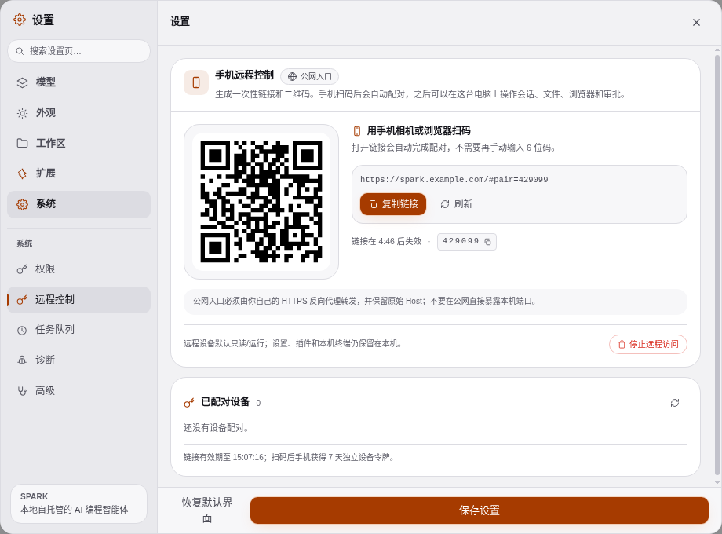
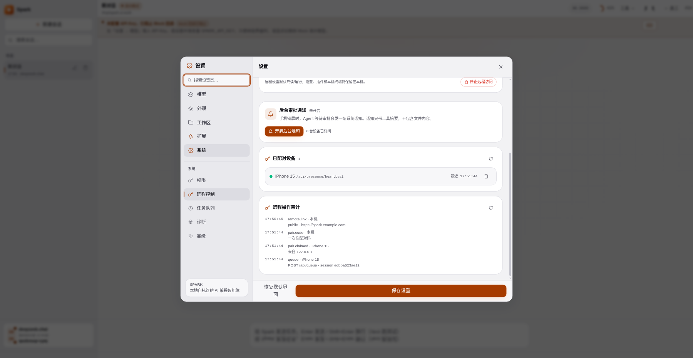
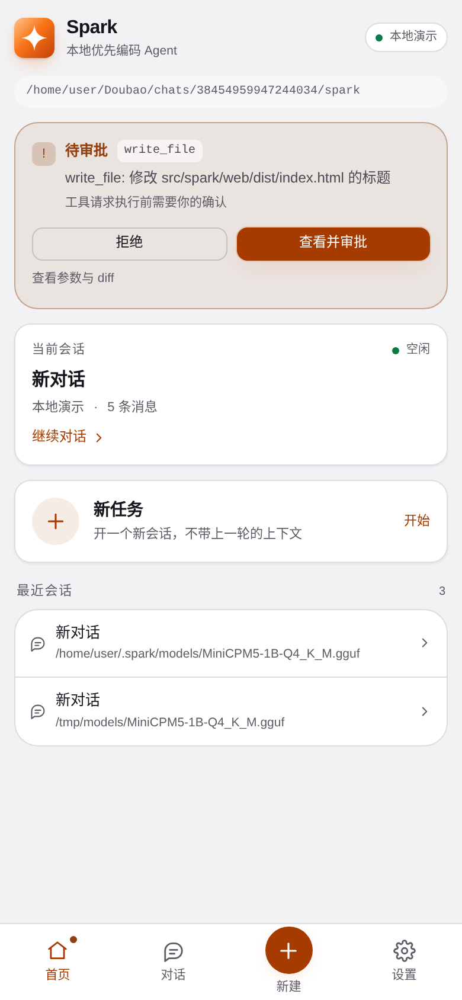
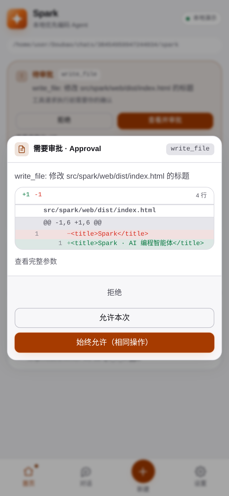
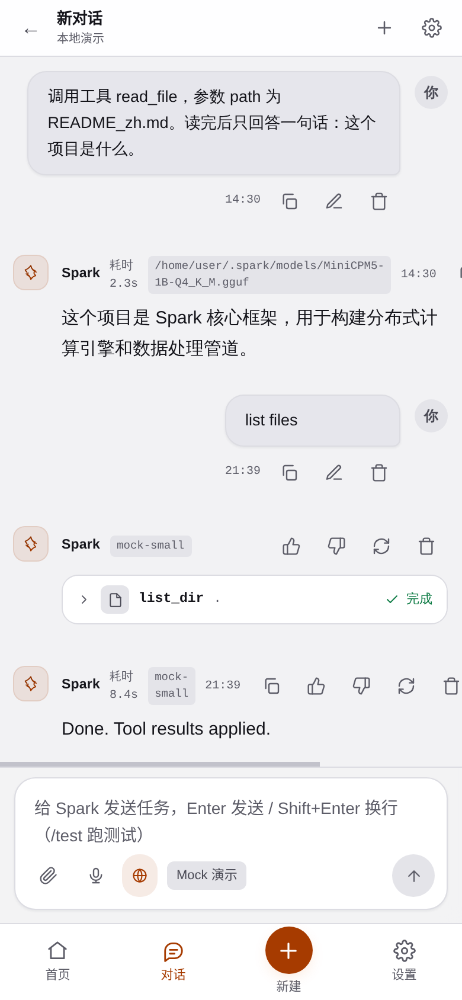
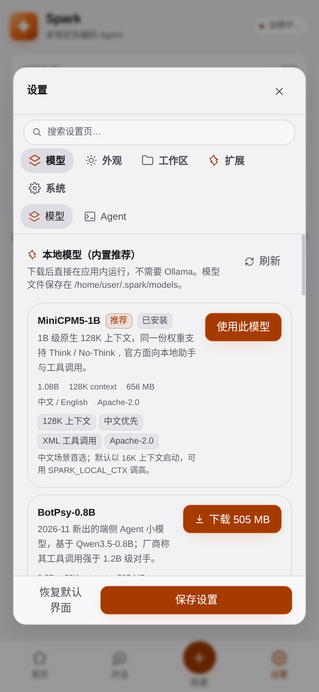

# Remote control

Scan a QR code on your phone to join the current Spark workspace. The desktop process remains the runtime: files, commands, models and approvals all execute on the original machine. The phone is another view of the same workbench.





## Phone layout

Below 768px Spark swaps the desktop shell (`Sidebar + Header + ChatView + RightPanel`) for a dedicated `MobileShell`:

- The first screen always shows pending approvals, the current session and a new task. A pending approval can be denied from the card, or opened in a details sheet and allowed — two taps.
- A fixed bottom bar holds Home / Chat / New / Settings; `100dvh` and `safe-area-inset-bottom` keep it from covering the composer.
- Chat reuses the existing SSE stream, session lease and `Composer`; ordinary visits also register the PWA `sw.js`, so the page is installable.
- The composer microphone uses browser `SpeechRecognition`; unsupported, denied or empty results show a toast and leave keyboard input untouched.









## Entry modes

| Mode | Use case | Link |
|---|---|---|
| Local | Browser on the same machine | Loopback only; no scannable link |
| LAN | Phone and computer on the same Wi-Fi | `http://<LAN IP>:<port>/#pair=<6-digit code>` |
| Public | Operate a home machine from the internet | `https://your-domain/#pair=<6-digit code>` through your own HTTPS reverse proxy |

The LAN listener starts on demand when you click **Generate QR code**; `spark web` does not open it by default. Declare a public origin at startup:

```bash
spark web --public-url https://spark.example.com
# or
SPARK_PUBLIC_URL=https://spark.example.com spark web
```

Only `scheme://host[:port]` is accepted. Paths, query strings and credentials are rejected. A reverse proxy must preserve the original `Host` and forward SSE/WebSocket long-lived connections.

### Use the outbound relay instead of an inbound reverse proxy

If the Spark machine cannot open an inbound port, the relay can expose the Web UI at its root. The relay and agent share one channel/key; the browser only talks to the relay and never receives the relay key:

```bash
# On the relay host with a public domain/TLS
spark relay serve --channel "$CHANNEL" --key "$SPARK_RELAY_KEY"

# On the machine running Spark (dials out)
spark relay connect --relay https://relay.example.com \
  --channel "$CHANNEL" --key "$SPARK_RELAY_KEY" \
  --upstream http://127.0.0.1:8000

# Make Spark Web generate relay-based pair links/QR codes
spark web --public-url https://relay.example.com
```

Opening `https://relay.example.com/#pair=<code>` forwards `/`, `/assets/*`, `/api/*`, `/sw.js` and SSE to the agent's loopback Web. One relay process exposes one channel. The relay itself is plaintext HTTP, so keep TLS in front; the relay key never reaches the browser, and Spark device tokens/pairing codes are still enforced. See `docs/RELAY.md`.

## Pairing flow

1. Open **Settings → System → Remote control** on the desktop and click **Generate QR code and link**.
2. Scan the code, or copy the link into a mobile browser.
3. The page sees `#pair=<code>`, calls `/api/pair/claim`, stores the device token, clears the fragment and reloads.
4. A device token lasts 7 days. The same panel shows online state, last request path, per-device revoke and **Stop remote access** for all devices.

The QR payload contains only the one-time URL, never a long-lived control key. The pairing code expires after 5 minutes; refreshing rotates the code and invalidates the old one immediately.

## Background approval alerts (Web Push)

A locked phone should not swallow an approval. Open **Settings → System → Remote control → Background approval alerts**, grant notification permission and press **Enable**. Spark then pushes a system notification when the agent enters `approval_needed`.

- The payload contains only a title, tool summary and target URL (`/#approval`); never file contents, prompts or tokens.
- Only approval events are pushed; ordinary turn completion does not spam the lock screen.
- Browsers require a secure context: an `https://` public origin or `localhost` can subscribe. LAN `http://192.168.x.x:port` cannot; the UI explains that HTTPS is required.
- On iPhone / iPad, Web Push needs iOS 16.4+ and the page added to the Home Screen, opened from there. A normal Safari tab is not guaranteed to work.
- The server generates a VAPID key on first use under `$SPARK_HOME/webpush.json`; subscriptions live in `$SPARK_HOME/webpush-subscriptions.json`, both mode `0600`. Changing the domain does not rotate the key, but changing `SPARK_HOME` invalidates old subscriptions.
- **Send test** is local-control only and verifies dependencies, keys and notification permission. `available: false` means `pywebpush` is missing; it is declared in `pyproject.toml`.

## Presence and audit trail

A paired page sends a heartbeat every minute while it is open. The device list marks a device online when it made a request in the last 120 seconds; after that it reads offline, but the token stays valid and the next request restores presence.

Remote writes are appended to `$SPARK_HOME/remote-audit.jsonl` (last 500 entries kept in memory, file appended, mode `0600`):

- messages, approvals, cancel, session create/switch/rename/fork, queue, browser actions, push subscribe/unsubscribe;
- successful pairing, per-device revoke, remote-link generation, stopping remote access, local push test.

Each entry has time, device name, action, target path and session ID. Prompts, file bodies and tokens are never recorded. The trail is readable only from the **local control plane**: `GET /api/remote/audit?limit=20`. A device token cannot read the global trail, so one phone cannot inspect another phone's history.

## Per-session lease and takeover

Only one device may drive a session at a time. `SessionRuntime` tracks `lease_owner` and `lease_until`:

- The first device to send a chat turn (`/api/chat`, `/api/chat/stream`) or write through the browser claims a free lease. Other devices get `409 lease_held` for writes, while reads (status, history, files, diff, execution graph) remain available.
- Approvals, question answers and cancellation are accepted only from the lease holder or the local control plane. Loopback always bypasses the lease so a disconnected phone cannot leave the session stuck.
- `/api/presence/heartbeat` renews both presence and the lease; 120 seconds without a heartbeat releases it automatically. Leases use a monotonic clock and are not persisted across process restarts.
- `GET /api/session/lease` returns `caller`, `lease.owner` and `expires_in`. `POST /api/session/lease` accepts `action: status | acquire | renew | release | takeover`; takeover writes a `session.lease.takeover` audit entry.
- `POST /api/chat` / `stream` may also pass `"takeover": true` to take over in one step. Ordinary concurrent writes should not use it; reserve it for deliberately stealing a session from another device.
- The `lease` field in the status response and the heartbeat response share the same snapshot, so the UI can show "another device is controlling this session".

## Temporary device_admin scope

Device tokens remain read/run only by default. When a phone needs to change non-shell settings or plugins, the local machine grants a one-shot 30-minute scope from the device row in Settings → System → Remote:

```bash
curl -X POST http://127.0.0.1:8899/api/remote/admin \
  -H "Content-Type: application/json" \
  -d '{"action":"grant","device_id":"dev_xxx"}'
```

Boundaries:

- Only the local control plane can grant it; a device cannot elevate itself. `/api/remote/admin`, `/api/shell`, `/api/pty/*` and `/api/remote/link|stop` stay denied to devices.
- After 30 minutes the scope drops back to `device`. Grant, expiry and revoke write `device.admin.grant`, `device.admin.expired` and `device.admin.revoke` audit entries; every admin write is still audited by its normal path.
- A pairing can use the admin scope once. Re-requesting after expiry or revocation returns `409`; revoke the device and pair again.
- Allowed: non-shell settings (display, model, context, memory, knowledge, prompts, skills) and plugin enable/disable.
- Denied: `agent.approval`, `agent.sandbox_mode`, `agent.network_access`, `agent.extra_dirs`, `agent.workdir_only`, `agent.protected_paths`, `agent.format_on_write`, `agent.auto_review`, `agent.allowed_tools`, `agent.shell_timeout_sec`, plus `hooks` / `mcp_servers`. These return `403 device_admin_field_denied`, so "settings" cannot be used to bypass approval or the sandbox.
- Plugin toggles still honor the plugin manifest permission gate; the admin scope only removes the remote restriction on changing plugins.

## Reverse proxy checklist

- Terminate HTTPS. Never expose Spark's plaintext port directly to the internet.
- Preserve the original `Host`; rewriting it to `127.0.0.1` makes Spark treat the request as local.
- Disable response buffering and allow long-lived SSE (`/api/chat/stream`).
- Proxy only the Spark Web port; do not publish `/api/pty/` separately.

Nginx:

```nginx
location / {
    proxy_pass http://127.0.0.1:8899;
    proxy_http_version 1.1;
    proxy_set_header Host $host;
    proxy_set_header X-Forwarded-Proto $scheme;
    proxy_buffering off;
    proxy_read_timeout 3600s;
}
```

Caddy:

```caddyfile
spark.example.com {
    reverse_proxy 127.0.0.1:8899 {
        header_up Host {host}
        flush_interval -1
    }
}
```

## Permission boundary

A paired phone is a read/run device, not a local administrator:

| Allowed | Not allowed |
|---|---|
| Send messages, stop/cancel a turn | Change model, approval or sandbox settings |
| Approve writes and commands | Enable/disable or install plugins |
| Switch, create, rename or fork sessions | Direct shell / PTY |
| Read files, diffs, execution graph and queue | Mint/revoke pairing codes or stop remote access |
| Enable/disable background alerts for this device | Read audit records from other devices |

This separates "remote-controlling the agent" from "remote-controlling the whole machine". Return to the desktop to manage settings or plugins. Public requests are always treated as device requests even when the reverse proxy connects over loopback; the break-glass control token is never accepted there.

## Troubleshooting

- **No LAN IPv4**: start with `spark web --host 0.0.0.0`, or configure `--public-url`.
- **QR opens but still asks for a token**: check that the proxy preserved `Host` and that the browser kept the `#pair=` fragment.
- **Page loads but messages do not stream**: disable proxy buffering and raise the read timeout.
- **Revoke one phone**: use the trash icon in the device list. **Stop remote access** revokes all devices and closes the temporary LAN listener.

Code lives in `src/spark/web/remote_access.py`, `remote.py`, `web_push.py`, `remote_api.py` and `routes.py`; the UI is `RemoteSection.tsx` / `RemotePush.tsx` / `RemoteUnlock.tsx` / `remotePush.ts`, with the Service Worker in `web/public/sw.js`. Regression coverage: `tests/test_remote_access.py`, `tests/test_remote_presence.py`, `tests/test_web_push.py`.
