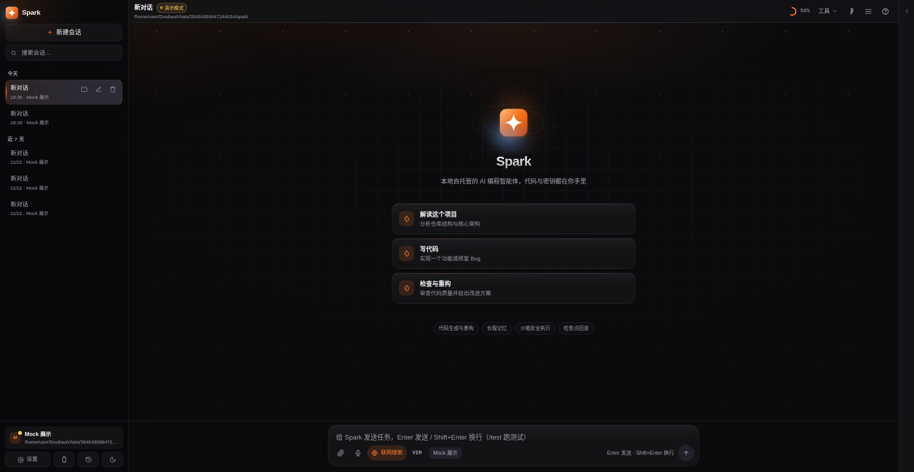
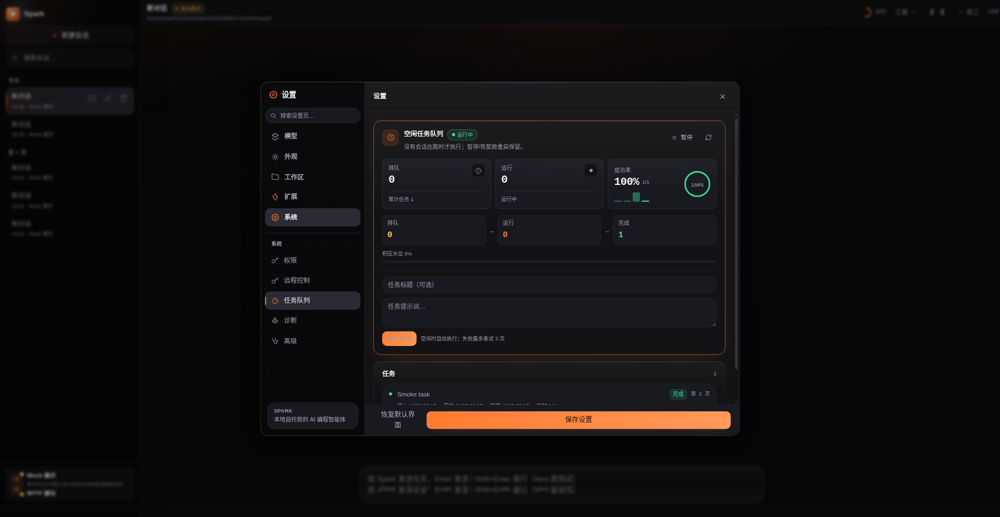
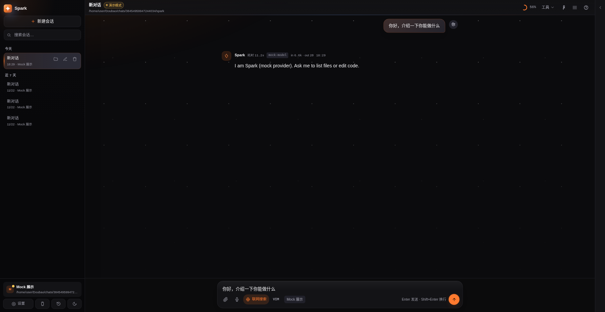

# Web 视觉系统 v2 验收记录

日期：2026-11-24  
范围：`web/src` 视觉层、组件观感、队列与成本可视化  
版本：`0.15.4`（未 bump）

## 这轮改了什么

### 1. 全局氛围层

- `body::before` 加入三团低饱和星云光雾（橙 / 蓝紫 / 绿），26 秒缓慢漂移。
- `body::after` 加入两层星点，9 秒呼吸；亮色下自动降为淡灰点，暗色下为白色星点。
- `App` 根节点改为透明 `app-frame`，氛围层不再被不透明画布吃掉。
- 移动端与粗指针设备关闭漂移动画，只保留静态氛围，避免低端机掉帧。

### 2. 面板、按钮、品牌

- `.surface` 改为「顶部受光 + 边缘高光 + 两层阴影」，hover 可上浮 2px。
- 新增 `.spotlight`：当前任务/运行中卡片有一圈很淡的强调色外发光。
- 主按钮改为渐变底 + hover 扫光，图标按钮 hover 时图标上浮 1px。
- `BrandMark` 增加旋转光晕 `brand-halo`，空态与侧栏品牌不再是一块静态方块。
- 顶栏、侧栏、设置弹层、输入区分别有独立的受光背景与渐变分隔线。

### 3. 空态与对话

- 空态品牌改为 `empty-orbit`：两层倾斜轨道缓慢旋转，配合外圈光晕。
- 建议卡改为 `surface-lift`，hover 整体上浮。
- 用户气泡改为 `bubble-user`：渐变底、强调色边框、内高光。
- 助手头像加 `assistant-avatar`，hover 出现一圈细描边。
- 运行中的工具卡加 `tool-running`：左侧呼吸条 + 横向扫描光。
- 当前会话选中项加 `session-active`：强调色渐变底 + 右侧光条。

### 4. 可视化组件

新增 `web/src/components/Visuals.tsx`，零图表库依赖：

- `Sparkline`：SVG 折线 + 面积填充，接受任意数值序列。
- `RingGauge`：环形进度，带 0.7s 缓动。
- `MiniBars`：迷你柱状分布。
- `StatCard`：标签 / 数值 / 提示 / 进度条 / 图标，统一统计卡样式。

已接入：

- 任务队列：排队、运行、成功率三张统计卡；成功率环形图；队列水位流水线；任务卡状态点与进度条；运行中任务使用不确定进度光带。
- 成本与缓存：总 token、缓存命中、调用次数、本会话成本改为统计卡；缓存命中环形图 + 进度条；成本按预算显示风险色。
- 执行图：React Flow 外框加 `graph-canvas`，节点 hover 提亮，边线使用强调色混合。

## 验证

- `cd web && npm run build` 通过。
  - i18n 门禁：1115 keys 对齐，1064 个 `t()` 调用可解析，无硬编码中文。
  - `tsc -b` 通过。
  - Vite 构建通过。
- 浏览器实测：
  - 亮色空态、暗色空态、对话页、设置 → 系统 → 任务队列。
  - 队列页显示真实 `Smoke task` 数据，成功率 100%，无假数据。
- `npm run lint` 仍有 7 个既有错误，全部位于 `web/scripts/check-i18n.mjs`（`process`/`console` 未定义、`stripCjk` 未使用），不是本轮引入；`RemoteUnlock` 与 `RightPanel` 各 1 条既有 hook 依赖警告。

## 截图

暗色空态：

任务队列可视化：

暗色对话页：

## 边界

本轮只完成视觉与可视觉交互层，没有改动后端协议、Autopilot 状态机或发布链路。Stage B/C/D 的工程项与外部签名/多租户条件仍是独立工作，不在本记录中宣称完成。
